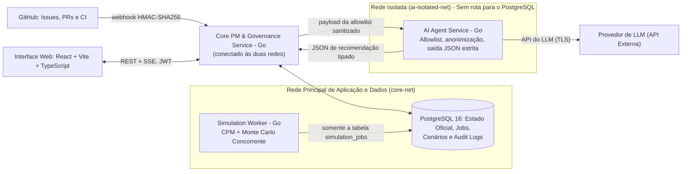
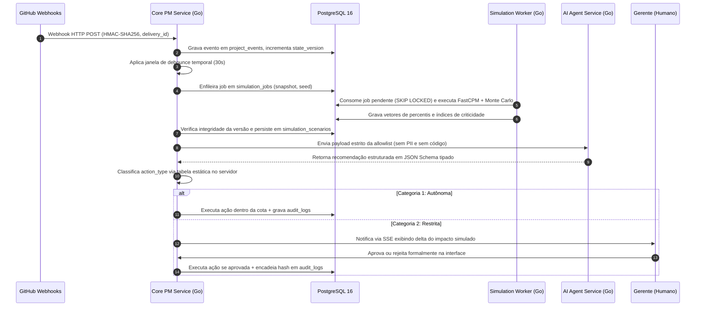
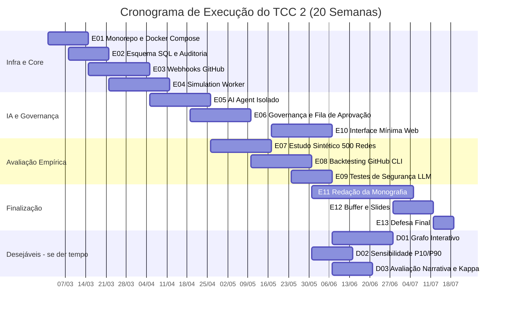

> **AVISO HISTÓRICO (LEGADO):** Este documento é uma versão histórica inicial da proposta e **diverge do texto principal oficial (Docs/Main.tex)** em título, autoria e numeração de requisitos. Mantido em Docs/legado/ apenas para registro de evolução.

# Proposta de Trabalho de Conclusão de Curso (TCC 1)

**UNIVERSIDADE DE BRASÍLIA — UnB**  
**FACULDADE DO GAMA — FGA**  
**CURSO DE ENGENHARIA DE SOFTWARE**  

---

# Gêmeo Digital e Inteligência Artificial para Apoio à Decisão em Projetos de Software: Especificação de uma Arquitetura de Referência com Simulação de Monte Carlo e Governança Humana

**Subtítulo:** Especificação de uma Arquitetura de Referência com Simulação de Monte Carlo e Governança Humana  
**Autor:** Carlos  
<!-- TODO(autor): incluir orientador(a), local e ano na capa conforme o modelo abnTeX2 da UnB -->
**Área de Concentração:** Engenharia de Software / Gerenciamento de Projetos  
**Referenciais Metodológicos:** PMBOK® Guide (7ª ed.) e PMI *Practice Standard for Scheduling*  
**Contexto de Aplicação:** Planejamento tático de *Releases* e Épicos técnicos em desenvolvimento iterativo/híbrido  
**Público-alvo:** Engenheiros de software, líderes técnicos e gerentes de projetos de software  

---

## Elementos Pré-Textuais

### Resumo

Projetos de desenvolvimento de software em ciclos iterativos ou híbridos enfrentam crônica incerteza de prazos, decorrente de dependências técnicas complexas entre componentes, estimativas humanas sujeitas a vieses cognitivos e volatilidade operacional de impedimentos. Embora ferramentas contemporâneas registrem tarefas passivamente, a desconexão em tempo real entre eventos operacionais de engenharia e modelos formais de rede impede a identificação precoce de desvios no caminho crítico. Simultaneamente, o uso não governado de Modelos de Linguagem de Larga Escala (LLMs) em sistemas corporativos expõe graves vulnerabilidades de segurança (injeção indireta de comandos e agência excessiva), além de alucinações numéricas em cálculos estocásticos. Este trabalho especifica a arquitetura de referência de um sistema de apoio à decisão concebido como uma Sombra Digital de processo com atuação governada sobre o modelo virtual. A solução articula a captura automatizada de eventos de repositórios e integração contínua (GitHub/CI), cálculo determinístico de caminho crítico (CPM), Simulação de Monte Carlo estocástica (distribuição PERT-Beta contínua acoplada a riscos discretos de Bernoulli) e geração de recomendações interpretativas via LLM isolado. A governança é garantida por classificação binária de impacto no servidor (*fail-closed*), retenção de ações críticas para aprovação humana com exibição de impacto simulado e auditoria encadeada criptograficamente por SHA-256. A viabilidade algorítmica do motor estocástico foi verificada por uma Prova de Conceito (PoC) autônoma em Go (`poc-engine`): o amostrador PERT-Beta foi validado contra a média e a variância analíticas; o CPM determinístico foi conferido contra o cálculo manual; a execução com 1, 4 e 16 *workers* concorrentes produziu resultados idênticos; e 10.000 iterações foram executadas em 5,8 ms em uma rede de 4 tarefas e em 260 ms em uma rede sintética de 200 tarefas e 300 dependências, ambas em um único núcleo de CPU e abaixo do limite de 1 s do requisito de latência. O documento apresenta a fundamentação teórica, os trabalhos relacionados e uma matriz comparativa de ferramentas; a caracterização, por script reprodutível, de janelas de *release* do repositório GitHub CLI (`cli/cli`) para o *backtesting*, que evidencia a baixa densidade de dados das janelas inicialmente previstas e propõe uma janela ampliada; e o cronograma do TCC 2 com estimativas de três pontos e linha de corte entre escopo essencial e desejável. A comparação de acurácia entre o modelo estocástico e as alternativas determinísticas é objeto do TCC 2.

**Palavras-chave:** Gêmeo Digital de Processo; Simulação de Monte Carlo; Método do Caminho Crítico; Governança de Inteligência Artificial; Engenharia de Software.

---

### Abstract

Software engineering projects in iterative or hybrid lifecycles suffer from chronic schedule uncertainty caused by intricate technical dependencies, human estimation biases, and operational impediments. While contemporary management tools passively record work items, the absence of real-time coupling between engineering execution events and formal network models hinders proactive detection of critical path shifts. Concurrently, ungoverned adoption of Large Language Models (LLMs) in enterprise systems exposes critical security vulnerabilities (indirect prompt injection, excessive agency) and numerical hallucinations in graph arithmetic. This work specifies the reference architecture of a decision-support system designed as a process Digital Shadow with governed in-model actuation. The architecture integrates automated event capture from version control and continuous integration (GitHub/CI), deterministic Critical Path Method (CPM), stochastic Monte Carlo Simulation (continuous PERT-Beta distribution coupled with Bernoulli discrete risks), and explanatory recommendations produced by an isolated LLM agent. Architectural governance is enforced through server-side deterministic binary impact classification (*fail-closed*), human-in-the-loop gating of restricted actions with simulated impact preview, and cryptographic SHA-256 hash-chained audit logging. Algorithmic feasibility was verified through an autonomous Go Proof of Concept (PoC) (`poc-engine`): the PERT-Beta sampler matches the analytical mean and variance; the deterministic CPM matches hand calculation; runs with 1, 4, and 16 concurrent workers produced identical results; and 10,000 iterations ran in 5.8 ms on a 4-task network and 260 ms on a synthetic 200-task/300-dependency network, both on a single CPU core and below the one-second latency requirement. The study provides the theoretical foundations, related work with a comparative matrix of existing tools, a reproducible-script characterization of GitHub CLI (`cli/cli`) release windows for historical backtesting, which reveals the low data density of the originally planned windows and proposes a wider one, and a TCC 2 schedule based on three-point estimates with an explicit cutoff between essential and desirable scope. The accuracy comparison against deterministic alternatives is left for TCC 2.

**Keywords:** Process Digital Twin; Monte Carlo Simulation; Critical Path Method; AI Governance; Software Engineering.

---

### Lista de Figuras

* Figura 1 — Rede de atividades do exemplo de validação (DAG) com estimativas de três pontos.
* Figura 2 — Densidades PERT-Beta ($\lambda = 4$) das tarefas T1 a T4 do exemplo de validação.
* Figura 3 — Níveis de integração e maturidade de Gêmeos Digitais (adaptado de Kritzinger et al., 2018).
* Figura 4 — Estrutura de encadeamento criptográfico da trilha de auditoria (SHA-256).
* Figura 5 — Arquitetura de referência em três processos e isolamento de redes (Docker Compose).
* Figura 6 — Diagrama de sequência do fluxo Evento → Simulação → IA → Fila de Aprovação → Auditoria.
* Figura 7 — Histograma e distribuição acumulada do término simulado (cenários A e B) na PoC em Go.
* Figura 8 — Cronograma Gantt do TCC 2 (20 semanas), com pacotes desejáveis abaixo da linha de corte.

---

### Lista de Tabelas

* Tabela 1 — Referenciais de gerenciamento de cronograma (PMBOK 7 e PMI *Practice Standard for Scheduling*) e sua tradução arquitetural.
* Tabela 2 — Trabalhos relacionados na literatura: análise comparativa de abordagens e lacunas.
* Tabela 3 — Matriz comparativa entre ferramentas existentes e o artefato proposto.
* Tabela 4 — Requisitos Funcionais do Sistema (RF01 a RF12).
* Tabela 5 — Requisitos Não Funcionais do Sistema (RNF01 a RNF09).
* Tabela 6 — Mapeamento formal de eventos GitHub/CI para o estado das tarefas.
* Tabela 7 — Catálogo de ações da IA e classificação determinística de governança no servidor.
* Tabela 8 — Caracterização quantitativa de janelas de *release* do GitHub CLI (`cli/cli`) para *backtesting*.
* Tabela 9 — Parâmetros e topologia da rede de validação da Prova de Conceito.
* Tabela 10 — Resultados da PoC em Go: Cenários A, B, C e C′ ($N = 10.000$, semente 42).
* Tabela 11 — Índice de Criticidade empírico (IC %) obtido pela PoC em Go.
* Tabela 12 — Validação analítica do amostrador PERT-Beta (média e variância).
* Tabela 13 — Reprodutibilidade estrita entre 1, 4 e 16 *workers* concorrentes (RNF08).
* Tabela 14 — *Benchmark* de desempenho computacional (RNF06).
* Tabela 15 — Protocolo consolidado de avaliação experimental (DSRM — 5 dimensões).
* Tabela 16 — Cronograma de execução do TCC 1 (16 semanas).
* Tabela 17 — Cronograma detalhado do TCC 2 (20 semanas) com estimativas O/M/P e linha de corte.
* Tabela 18 — Matriz de riscos da pesquisa e estratégias de mitigação.

---

### Lista de Abreviaturas e Siglas

* **ABNT** — Associação Brasileira de Normas Técnicas
* **ACID** — Atomicidade, Consistência, Isolamento e Durabilidade
* **API** — *Application Programming Interface*
* **CI/CD** — *Continuous Integration / Continuous Delivery*
* **CPM** — *Critical Path Method* (Método do Caminho Crítico)
* **DAG** — *Directed Acyclic Graph* (Grafo Acíclico Dirigido)
* **DSRM** — *Design Science Research Methodology*
* **EF** — *Early Finish* (Término Mais Cedo)
* **ES** — *Early Start* (Início Mais Cedo)
* **FGA** — Faculdade do Gama
* **FS** — *Finish-to-Start* (Término-a-Início)
* **HMAC** — *Hash-based Message Authentication Code*
* **IC** — Índice de Criticidade
* **IEEE** — *Institute of Electrical and Electronics Engineers*
* **ISO** — *International Organization for Standardization*
* **JWT** — *JSON Web Token*
* **LF** — *Late Finish* (Término Mais Tarde)
* **LLM** — *Large Language Model* (Modelo de Linguagem de Larga Escala)
* **LS** — *Late Start* (Início Mais Tarde)
* **MVP** — *Minimum Viable Product* (Produto Mínimo Viável)
* **OWASP** — *Open Web Application Security Project*
* **PERT** — *Program Evaluation and Review Technique*
* **PII** — *Personally Identifiable Information* (Informações de Identificação Pessoal)
* **PMBOK** — *Project Management Body of Knowledge*
* **PMI** — *Project Management Institute*
* **PoC** — *Proof of Concept* (Prova de Conceito)
* **PR** — *Pull Request*
* **PRNG** — *Pseudo-Random Number Generator*
* **RCPSP** — *Resource-Constrained Project Scheduling Problem*
* **REST** — *Representational State Transfer*
* **RNG** — *Random Number Generator*
* **RQ** — *Research Question* (Questão de Pesquisa)
* **SHA** — *Secure Hash Algorithm*
* **SLR** — *Systematic Literature Review*
* **SPA** — *Single Page Application*
* **SSE** — *Server-Sent Events*
* **TF** — *Total Float* (Folga Total)
* **UnB** — Universidade de Brasília
* **WBS** — *Work Breakdown Structure* (Estrutura Analítica do Projeto — EAP)

---

## 1. Introdução

### 1.1 Contextualização e Motivação com Dados Empíricos

O cumprimento de prazos em projetos de software permanece como um desafio crônico da Engenharia de Software. Dados longitudinais compilados pela indústria tecnológica confirmam que desvios de cronograma não constituem anomalias isoladas, mas sim a norma da disciplina. O relatório internacional *CHAOS Report* (STANDISH GROUP, 2020), baseado na análise empírica de mais de 50.000 projetos de tecnologia da informação ao redor do mundo, revelou que **apenas 31% dos projetos de software são entregues com sucesso pleno** (cumprindo prazo, custo e escopo planejados). Os restantes 69% distribuem-se entre projetos desafiados, isto é, concluídos com atraso, estouro de custo ou escopo reduzido (50%), e projetos fracassados, cancelados antes da conclusão ou entregues e nunca utilizados (19%). Ressalva-se que as definições e a metodologia do *CHAOS Report* são alvo de crítica na literatura (EVELEENS; VERHOEF, 2010); por isso, esses percentuais são usados aqui apenas como indicador de contexto, e não como evidência primária. De maneira complementar, o relatório global *Pulse of the Profession* (PMI, 2020) aponta que, em média, **11,4% do capital investido em projetos é desperdiçado** em razão do baixo desempenho dos projetos.

No desenvolvimento de software orientado a métodos iterativos, ágeis ou híbridos, as equipes operam focadas em fluxos contínuos de cartões e *sprints*. No entanto, no nível tático de planejamento — como a coordenação de *Releases*, marcos contratuais e épicos de integração arquitetural —, existem dependências técnicas rígidas do tipo Término-a-Início ($FS$) entre componentes (por exemplo: modelagem de esquemas de banco, construção de serviços centrais de backend, barramento de mensageria e interfaces de usuário). A literatura clássica e contemporânea demonstra que estimativas humanas sofrem invariavelmente da chamada "falácia do planejamento" (*planning fallacy*), viés cognitivo pelo qual profissionais subestimam sistematicamente tempos e custos mesmo dispondo de experiência prévia em tarefas análogas (BROOKS JR., 1995; KAHNEMAN; TVERSKY, 1979; JØRGENSEN, 2004). Quando eventos do ecossistema de desenvolvimento (fechamento de *issues*, abertura de *pull requests*, quebras de testes em *pipelines* de CI) ocorrem desconectados de uma rede analítica formal, os gestores operam "às cegas", detectando desvios críticos apenas nas fases terminais do cronograma.

As ferramentas comerciais de mercado (como Jira Software e Azure DevOps) limitam-se, em sua grande maioria, a cadastros tabulares e painéis (*dashboards*) estáticos de acompanhamento retrospectivo. Quando oferecem extensões de planejamento, baseiam-se em cálculos determinísticos lineares que ignoram a variabilidade inerente às tarefas humanas e o fenômeno estatístico de convergência de caminhos paralelos (*merge event bias*), no qual o prazo final é determinado pelo valor máximo de variáveis estocásticas ($E[\max(X, Y)] \ge \max(E[X], E[Y])$) (VAN SLYKE, 1963; MACCRIMMON; RYAVEC, 1964).

Por outro lado, a recente onda de adoção de Inteligência Artificial Generativa e Modelos de Linguagem de Larga Escala (LLMs) tem motivado a integração direta de assistentes conversacionais à gestão de projetos. No entanto, modelos probabilísticos de linguagem são inerentemente inadequados para aritmética precisa de grafos e simulações estocásticas, apresentando alucinações numéricas frequentes. Mais grave ainda, conceder agência operacional a LLMs conectados a repositórios expõe os sistemas a ataques de injeção indireta de comandos (*indirect prompt injection*), em que instruções maliciosas embutidas em títulos de *commits*, *issues* ou revisões de código manipulam o agente para aprovar alterações indevidas ou vazar dados estratégicos (GRESHAKE et al., 2023; OWASP, 2023; DEBENEDETTI et al., 2024).

Diante dessa lacuna, este trabalho propõe a concepção, formalização e validação de uma arquitetura de referência que une a disciplina quantitativa da Pesquisa Operacional e da Engenharia de Software ao poder explicativo da inteligência artificial sob governança estrita.

### 1.2 Pergunta de Pesquisa Central e Questões Específicas

Para sintetizar o foco científico da investigação, define-se a seguinte **Pergunta de Pesquisa Central (Primary Research Question)**:

> **Como conceber e validar uma arquitetura de referência de software que mantenha uma representação digital sincronizada de um projeto, integrando simulação estocástica de cronograma com assistência de IA generativa, de modo a assegurar previsões calibradas, governança determinística e proteção comprovada contra ações não autorizadas?**

Para operacionalizar a investigação científica e estruturar a validação segundo a DSRM (PEFFERS et al., 2007), formulam-se quatro Questões de Pesquisa Específicas (**RQs**):

* **RQ1 (Modelagem e Sincronização):** Quais entidades conceituais, propriedades estruturais e eventos automatizados de engenharia de software são necessários para constituir uma representação digital viva de processo (no nível de Sombra Digital governada) voltada ao acompanhamento tático de escopo, cronograma e riscos?
* **RQ2 (Simulação, Desempenho e Isolamento):** Como estruturar o cálculo determinístico de caminho crítico (CPM) e a Simulação de Monte Carlo acoplada a riscos discretos (PERT-Beta + Bernoulli) para garantir execução concorrente de alto desempenho, isolamento estrito de cenários hipotéticos e reprodutibilidade numérica independente de plataforma e concorrência?
* **RQ3 (Governança, Segurança e Explicabilidade da IA):** Quais mecanismos arquiteturais e fronteiras de isolamento garantem que agentes baseados em LLMs atuem exclusivamente sobre dados autorizados (*allowlist*), sem permissão de mutação direta em banco, contidos por classificação binária de impacto no servidor e com auditabilidade criptográfica imutável?
* **RQ4 (Qualidade e Calibração da Previsão):** Em que medida a abordagem probabilística baseada em Simulação de Monte Carlo com PERT-Beta produz intervalos de confiança calibrados e menores erros absolutos de previsão de término em comparação ao CPM determinístico e à extrapolação por vazão média — e qual o comportamento do modelo sob violação de suas premissas teóricas?

### 1.3 Proposição Central e Hipóteses de Pesquisa

A proposição central deste trabalho sustenta que uma arquitetura orientada a eventos, dividida em três processos desacoplados em nível de rede e conteinerização — combinando captura automatizada de eventos de desenvolvimento (Git/CI), simulação estocástica PERT-Beta/Bernoulli e um agente de IA contido por classificação determinística no servidor e aprovação humana — satisfaz simultaneamente três hipóteses mensuráveis:

* **Hipótese 1 (H1 — Previsão Probabilística Superior):** A previsão estocástica no percentil $P_{85}$ apresenta calibração empírica superior e menor erro médio absoluto de término de marcos do que a estimativa determinística CPM tradicional e do que a projeção linear ingênua por vazão média (RQ4).
* **Hipótese 2 (H2 — Segurança e Contenção Arquitetural):** Nenhuma entrada textual livre, ainda que contendo padrões adversariais de injeção indireta de comandos (*prompt injection*), consegue provocar mutação de estado oficial sem validação estrutural do servidor e autorização humana explícita, mantendo a integridade da linha de base em 100% dos testes (RQ3).
* **Hipótese 3 (H3 — Rastreabilidade e Explicabilidade Contínua):** Toda sugestão analítica emitida pelo sistema possui rastreabilidade unívoca aos indicadores matemáticos de suporte ($P_{50}, P_{85}$, Índice de Criticidade), sendo registrada em trilha de auditoria encadeada imutável resistente a adulterações (RQ1 e RQ3).

### 1.4 Objetivos

#### 1.4.1 Objetivo Geral
Projetar, formalizar e validar a arquitetura de referência de um sistema de apoio à decisão para gerenciamento tático de projetos de software, fundamentado no conceito de Sombra Digital de processo, Simulação de Monte Carlo concorrente e governança de inteligência artificial, comprovando a viabilidade algorítmica por Prova de Conceito (PoC) em Go e estruturando o protocolo experimental completo de validação para o TCC 2.

#### 1.4.2 Objetivos Específicos
1. **Fundamentar teórica e comparativamente a proposta:** Sistematizar os conceitos do PMBOK 7, PMI *Practice Standard for Scheduling*, maturidade de gêmeos digitais, análise estocástica de cronogramas e defesas contra injeção de *prompts*; construir a matriz de trabalhos relacionados e a matriz comparativa de ferramentas existentes.
2. **Especificar requisitos, governança e modelo de dados:** Definir formalmente requisitos funcionais e não funcionais, contratos de eventos Git/CI, esquema de banco de dados segregando estado oficial, cenários *what-if* e trilha de auditoria encadeada por *hash*.
3. **Formalizar o motor estocástico e implementar PoC:** Especificar os algoritmos de ordenação topológica, CPM, amostragem PERT-Beta via Marsaglia-Tsang e riscos de Bernoulli; implementar a Prova de Conceito em Go e comprovar experimentalmente a corretude, a reprodutibilidade sob concorrência e a latência de execução.
4. **Caracterizar empiricamente as janelas de *backtesting*:** Selecionar um repositório *open-source* real e consolidado (GitHub CLI `cli/cli`), extrair, por script reprodutível, métricas de *cycle time* de janelas de *release* consecutivas, avaliar sua suficiência para o *backtesting* e parametrizar o protocolo de teste histórico.
5. **Planejar o TCC 2 com estimativas de três pontos:** Estruturar o cronograma analítico de 20 semanas do TCC 2 em diagrama de Gantt, calculando incertezas (O/M/P) e demarcando a linha de corte (*cutoff*) de entregas essenciais versus desejáveis.

### 1.5 Organização do Documento

Este trabalho organiza-se da seguinte forma:
* O **Capítulo 2 (Fundamentos Teóricos)** introduz os conceitos matemáticos e computacionais essenciais: Método do Caminho Crítico (CPM), parametrização da distribuição PERT-Beta, Simulação de Monte Carlo, níveis de maturidade de Gêmeos Digitais segundo Kritzinger et al. (2018) e modelo de ameaças da OWASP para LLMs.
* O **Capítulo 3 (Trabalhos Relacionados e Matriz de Ferramentas)** examina 8 estudos científicos correlatos e sintetiza a matriz comparativa do estado da arte e das ferramentas de mercado.
* O **Capítulo 4 (Requisitos, Arquitetura e Modelo de Governança)** detalha a topologia de três processos isolados, modelo conceitual de dados, catálogo determinístico de governança, auditoria encadeada e tecnologias selecionadas com referências.
* O **Capítulo 5 (Caracterização Empírica das Janelas de *Backtesting*)** descreve a extração e a caracterização de janelas de *release* do repositório GitHub CLI, a baixa densidade de dados observada e o protocolo de corte temporal.
* O **Capítulo 6 (Prova de Conceito e Validação Algorítmica)** apresenta a implementação da PoC em Go, a reprodução dos cenários da Tabela 10, a validação analítica do amostrador, o teste de reprodutibilidade concorrente (1, 4 e 16 *workers*) e *benchmarks* de desempenho.
* O **Capítulo 7 (Metodologia e Protocolo de Avaliação do TCC 2)** define o enquadramento DSRM e o detalhamento das 5 dimensões de avaliação.
* O **Capítulo 8 (Cronograma do TCC 1 e TCC 2 com Linha de Corte)** estabelece o planejamento temporal detalhado com estimativas de três pontos e gestão de contingência.
* O **Capítulo 9 (Riscos, Resultados Esperados e Limitações Declaradas)** consolida a matriz de riscos e as limitações declaradas com honestidade acadêmica.
* O **Capítulo 10 (Conclusão e Próximos Passos)** resume as entregas do TCC 1, os resultados e os próximos passos.
* Seguem-se os **Apêndices** e as **Referências Bibliográficas** padronizadas em ABNT NBR 6023.

---

## 2. Fundamentos Teóricos

### 2.1 Gerenciamento de Cronograma e o Método do Caminho Crítico (CPM)

O gerenciamento de cronogramas em projetos complexos fundamenta-se historicamente no Método do Caminho Crítico (*Critical Path Method* — CPM), desenvolvido por Kelley e Walker (1959). Um cronograma estruturado é representado como um Grafo Acíclico Dirigido (DAG) $G = (V, E)$, em que os vértices $V = \{1, 2, \dots, n\}$ correspondem às atividades ou tarefas de trabalho, e as arestas direcionadas $(u, v) \in E$ expressam restrições de precedência técnica do tipo Término-a-Início ($FS$ — *Finish-to-Start*), indicando que a tarefa sucessora $v$ só pode ser iniciada após a conclusão integral de sua predecessora $u$.

A análise de rede por CPM é executada em dois passos determinísticos:
1. **Passo Direto (*Forward Pass*):** Determina os tempos mais cedo em que as atividades podem ocorrer, propagando a partir da data de início ($t = 0$ ou data de status $t_s$):
   $$\text{Early Start: } ES_i = \begin{cases} 0, & \text{se } \text{Pred}(i) = \emptyset \\ \max_{u \in \text{Pred}(i)} EF_u, & \text{caso contrário} \end{cases}$$
   $$\text{Early Finish: } EF_i = ES_i + d_i$$
   A duração mínima esperada do projeto ($T_{\text{CPM}}$) corresponde ao término mais cedo de seus nós terminais:
   $$T_{\text{CPM}} = \max_{i \in V} EF_i$$

2. **Passo Inverso (*Backward Pass*):** Determina os limites mais tardios em que cada tarefa pode ser realizada sem postergar a data final do projeto:
   $$\text{Late Finish: } LF_i = \begin{cases} T_{\text{CPM}}, & \text{se } \text{Succ}(i) = \emptyset \\ \min_{v \in \text{Succ}(i)} LS_v, & \text{caso contrário} \end{cases}$$
   $$\text{Late Start: } LS_i = LF_i - d_i$$

A flexibilidade de agendamento de cada tarefa é quantificada pela **Folga Total (*Total Float* — $TF_i$):**
$$TF_i = LF_i - EF_i = LS_i - ES_i$$

Uma atividade pertence ao **Caminho Crítico** se e somente se sua folga total for nula ($TF_i = 0$). Em computação de ponto flutuante (`float64`), adota-se a tolerância de limiar $|TF_i| < \varepsilon$, com $\varepsilon = 10^{-9}$. O caminho crítico representa o encadeamento mais longo de tarefas dependentes; qualquer atraso em uma tarefa crítica acarreta atraso idêntico no término global do projeto.

Os referenciais de gerenciamento de cronograma adotados e sua tradução no artefato estão sintetizados na Tabela 1, e a Figura 1 apresenta a rede de atividades usada como exemplo de validação ao longo deste trabalho.

#### Tabela 1 — Referenciais de gerenciamento de cronograma e sua tradução arquitetural

| Referencial | Elemento relevante | Tradução no artefato |
| :--- | :--- | :--- |
| *PMBOK Guide*, 7. ed. (PMI, 2021) | Domínios de desempenho de planejamento, incerteza e mensuração | Rede de atividades com estimativas de três pontos; riscos como eventos discretos; indicadores de previsão ($P_{50}$, $P_{85}$, IC) |
| *Practice Standard for Scheduling*, 3. ed. (PMI, 2019) | Modelo de cronograma, análise do caminho crítico e análise de risco de cronograma | CPM acíclico com folga total; Simulação de Monte Carlo sobre o modelo; cenários *what-if* |
| Ambos | Rastreabilidade e controle da linha de base | `state_version`, `simulation_scenarios` e auditoria encadeada |

*Fonte: Elaborado pelo autor.*

*Figura 1 — Rede de atividades do exemplo de validação (DAG) com estimativas de três pontos $(t_o/t_m/t_p)$ e duração esperada $\mu$. Fonte: Elaborado pelo autor.*

### 2.2 Estimativa de Três Pontos e a Distribuição PERT-Beta

Na Engenharia de Software, as tarefas sofrem forte variabilidade decorrente de incertezas técnicas, complexidade cognitiva e desvios de escopo. A técnica clássica PERT (*Program Evaluation and Review Technique*), proposta por Malcolm et al. (1959), modela cada tarefa através de três estimativas temporais fornecidas por especialistas:
* $t_o$: estimativa **otimista** (cenário ideal, sem contratempos);
* $t_m$: estimativa **mais provável** ou modal (cenário padrão);
* $t_p$: estimativa **pessimista** (cenário adverso, em que tudo dá errado, exceto catástrofes extremas).

Tradicionalmente, a média esperada da distribuição Beta simplificada é calculada por:
$$\mu_i = \frac{t_{o,i} + \lambda t_{m,i} + t_{p,i}}{\lambda + 2}$$
Adota-se universalmente o peso modal $\lambda = 4$, resultando na consagrada fórmula PERT: $\mu = \frac{t_o + 4t_m + t_p}{6}$.

Enquanto a aproximação histórica de Malcolm et al. (1959) estimava a variância como $\sigma^2 \approx \left(\frac{t_p - t_o}{6}\right)^2$, matemáticos como MacCrimmon e Ryavec (1964) demonstraram que tal simplificação introduz erros sistemáticos quando a distribuição é assimétrica. Neste trabalho, implementa-se a formulação estrita da **distribuição Beta contínua** com suporte delimitado em $[t_o, t_p]$. Os parâmetros de forma $\alpha$ e $\beta$ são calculados com base no fator $\lambda = 4$:
$$\alpha_i = 1 + \lambda \left(\frac{t_{m,i} - t_{o,i}}{t_{p,i} - t_{o,i}}\right), \qquad \beta_i = 1 + \lambda \left(\frac{t_{p,i} - t_{m,i}}{t_{p,i} - t_{o,i}}\right)$$
Observe que, sob $\lambda = 4$, a soma dos parâmetros de forma é sempre constante: $\alpha_i + \beta_i = 6$. A variância analítica exata dessa distribuição Beta é dada por:
$$\sigma_i^2 = \frac{(\mu_i - t_{o,i})(t_{p,i} - \mu_i)}{\lambda + 3} = \frac{(\mu_i - t_{o,i})(t_{p,i} - \mu_i)}{7}$$
Essa formulação matemática garante flexibilidade para modelar caudas assimétricas sem incorrer em suposições arbitrárias de normalidade.

*Figura 2 — Densidades PERT-Beta ($\lambda = 4$) das tarefas T1 a T4; linhas pontilhadas indicam a estimativa mais provável $t_m$. Fonte: Elaborado pelo autor.*

### 2.3 Simulação de Monte Carlo e o Viés de Convergência de Caminhos

A aplicação do CPM tradicional utilizando médias determinísticas ($\mu_i$) produz estimativas sistematicamente otimistas em redes que possuem múltiplos caminhos concorrentes. Conforme demonstrado por Van Slyke (1963), em pontos de convergência (*merge nodes*) onde duas ou mais cadeias paralelas se unem, a data de início da atividade subsequente depende do término da cadeia mais demorada:
$$T = \max(X_1, X_2, \dots, X_m)$$
Como a esperança do valor máximo de variáveis aleatórias independentes é maior ou igual ao máximo de suas esperanças individuais ($E[\max(X, Y)] \ge \max(E[X], E[Y])$), o CPM determinístico subestima a data de conclusão do projeto, fenômeno conhecido como **viés de convergência de caminhos (*merge event bias*)**.

A Simulação de Monte Carlo trata esse problema numericamente, executando $N$ iterações independentes (tipicamente $N = 10.000$). Em cada rodada $k \in \{1, \dots, N\}$, sorteia-se um valor pseudo-aleatório de duração para cada atividade $X_{i,k} \sim \text{Beta}(\alpha_i, \beta_i)$ (obtido como razão de variáveis Gama amostradas pelo método de Marsaglia e Tsang (2000) e reescalado para $[t_o, t_p]$), escala-se pelo progresso não realizado $(1 - c_i)$, aplicam-se os riscos discretos de Bernoulli, e resolve-se o CPM completo. O resultado consolida uma distribuição acumulada de probabilidade do término do projeto ($F_{(1)} \le F_{(2)} \le \dots \le F_{(N)}$), permitindo extrair percentis gerenciais de compromisso:
* $P_{50}$: data mediana (50% de probabilidade de cumprimento);
* $P_{85}$: nível tático de compromisso adotado neste trabalho (85% de confiança);
* $P_{95}$: compromisso de alta certeza para acordos contratuais rígidos.

Adicionalmente, a simulação computa o **Índice de Criticidade ($IC_i$)** de cada tarefa, que expressa a fração de iterações em que a atividade $i$ esteve no caminho crítico:
$$IC_i = \frac{1}{N} \sum_{k=1}^N \mathbb{I}(|TF_{i,k}| < \varepsilon) \times 100\%$$

### 2.4 Conceito e Níveis de Maturidade de Gêmeos Digitais

O conceito de Gêmeo Digital (*Digital Twin*) originou-se na engenharia aeroespacial e de manufatura fabril, onde foi objeto de normalização como arcabouço de referência (ISO, 2021). Kritzinger et al. (2018), em estudo taxonômico referencial, classificam a integração entre sistemas físicos (reais) e seus modelos virtuais em três níveis distintos de maturidade:
1. **Modelo Digital (*Digital Model*):** Representação virtual cuja troca de dados com o sistema físico ocorre de maneira inteiramente manual em ambos os sentidos.
2. **Sombra Digital (*Digital Shadow*):** O fluxo de dados do sistema físico para a representação virtual é automatizado e unidirecional (sensores, eventos e rastreamento em tempo real); as ações corretivas de retorno sobre o mundo real continuam sendo decididas e executadas manualmente.
3. **Gêmeo Digital (*Digital Twin*):** O fluxo de integração é completamente bidirecional e automatizado; o modelo virtual não apenas reflete o estado do sistema físico, mas comanda atuações automáticas diretas sobre ele sem intermediação humana contínua.

*Figura 3 — Níveis de integração e maturidade de Gêmeos Digitais (adaptado de Kritzinger et al., 2018). Fonte: Elaborado pelo autor.*

Na Engenharia de Software, o objeto gerenciado não é uma máquina física, mas um processo sócio-técnico composto por desenvolvedores, repositórios e tarefas (GUINEA-CABRERA; HOLGADO-TERRIZA, 2024; LEHNER et al., 2025). Conforme delimitado rigorosamente neste trabalho, o artefato proposto enquadra-se no nível de **Sombra Digital com atuação governada sobre o próprio modelo e apoio humano à decisão**: a sincronização do mundo real para o modelo virtual é automatizada por *webhooks* Git/CI, enquanto a retroalimentação no mundo real dá-se mediante aprovação explícita do gestor humano (*human-in-the-loop*).

### 2.5 Vulnerabilidades e Governança de Agentes Baseados em LLM

A integração de Modelos de Linguagem de Larga Escala (LLMs) em processos corporativos expõe superfícies de ataque inéditas, catalogadas pelo consórcio *Open Web Application Security Project* (OWASP, 2023). Dentre elas, destacam-se:
* **OWASP LLM01 — Injeção Indireta de Prompt (*Indirect Prompt Injection*):** Ocorre quando um atacante manipula fontes de dados externas não confiáveis que são consumidas pelo LLM (como descrições de *issues*, mensagens de *commit* ou títulos de PRs). O modelo interpreta o texto adversarial como uma instrução imperativa de sistema, subvertendo regras de negócio ou induzindo ações indevidas (GRESHAKE et al., 2023).
* **OWASP LLM06 — Agência Excessiva (*Excessive Agency*):** Ocorre quando uma aplicação concede ao LLM permissões operacionais desproporcionais, como permissão direta de escrita ou exclusão em bancos de dados, permitindo que falhas de raciocínio ou ataques adversariais provoquem mutações destrutivas e irreversíveis.

Para mitigar tais riscos de forma comprovável, a arquitetura deste trabalho adota **isolamento de rede estrito** do contêiner da IA (sem driver ou rota para o PostgreSQL), esquemas JSON estáticos com validação tipada e **classificação binária determinística de impacto no servidor**, garantindo que nenhuma alteração crítica seja efetivada sem anuência humana expressa.

---

## 3. Trabalhos Relacionados e Matriz de Ferramentas

### 3.1 Trabalhos Relacionados

A Tabela 2 sintetiza 8 estudos centrais que fundamentam o estado da arte e destacam a lacuna endereçada por esta pesquisa. Os trabalhos foram selecionados por relevância ao problema, sem protocolo formal de revisão sistemática. A previsão probabilística de projetos ágeis por simulação de Monte Carlo sobre vazão histórica é ainda tratada por Vacanti (2015) e Magennis (2011), que fundamentam ferramentas como as da Tabela 3.

#### Tabela 2 — Trabalhos relacionados na literatura: análise comparativa de abordagens e lacunas

| Autor / Ano | Foco e Domínio | Abordagem Quantitativa | Integração com IA | Nível de Gêmeo Digital | Limitações Observadas |
| :--- | :--- | :--- | :--- | :--- | :--- |
| **Guinea-Cabrera e Holgado-Terriza (2024)** | Revisão Sistemática da Literatura sobre Gêmeos Digitais em Eng. Software | Qualitativa / Conceitual | Não abordado | Mapeia taxonomias (Modelo, Sombra e Gêmeo) | Estudo bibliográfico; não propõe arquitetura executável ou motor estocástico. |
| **Lehner et al. (2025)** | Mapeamento sistemático da aplicação de técnicas de Engenharia Dirigida por Modelos (MDE) a gêmeos digitais em múltiplos domínios | Mapeamento sistemático (66 estudos selecionados de 189) | Não abordado | Caracteriza tipos de gêmeos digitais e sistemas gêmeados | Não trata de processos de desenvolvimento de software nem de simulação de cronogramas. |
| **Hulett (2000)** | Análise quantitativa de risco em cronogramas de engenharia | Simulação de Monte Carlo vs PERT determinístico | Inexistente | Modelo estático clássico | Não contempla sincronização automática por eventos modernos (Git/CI) nem IA. |
| **Van Slyke (1963)** | Formulação seminal de Monte Carlo aplicado a redes PERT | Simulação estocástica de caminhos paralelos | Inexistente | Modelo computacional em lote (*batch*) | Não modela progresso em tempo real, governança de ações ou mitigação de riscos discretos. |
| **Vacanti (2015)** | Previsão probabilística de fluxo em métodos ágeis / Kanban | Monte Carlo baseado em vazão (*throughput*) | Inexistente | Métricas de fluxo contínuo | Desconsidera dependências técnicas de predecessão $FS$, inviável para épicos complexos. |
| **Jørgensen (2004)** | Revisão sistemática sobre estimativas de esforço de software | Métodos empíricos e vieses de especialistas | Inexistente | Modelos econométricos | Focado em diagnóstico comportamental humano; não provê ferramental de simulação ativa. |
| **Greshake et al. (2023)** | Ataques de injeção indireta de *prompt* em aplicações LLM | Análise empírica de vulnerabilidade | Agentes baseados em LLM | Não se aplica | Focado exclusivamente no ataque; não constrói arquitetura defensiva de governança corporativa. |
| **Debenedetti et al. (2024 — AgentDojo)** | *Benchmark* de avaliação de segurança em agentes LLM | Testes adversariais estruturados | Agentes LLM com chamadas de ferramenta | Não se aplica | Ambiente de teste isolado; não endereça gerenciamento de processos e cronogramas. |
| **Este Trabalho (2026)** | Apoio à decisão em cronogramas de software | **CPM + Monte Carlo (PERT-Beta + Bernoulli)** | **LLM isolado com classificação determinística** | **Sombra Digital com atuação governada** | Focado em planejamento tático $FS$; recursos ilimitados no MVP (RCPSP como extensão). |

*Fonte: Elaborado pelo autor.*

### 3.2 Matriz Comparativa de Ferramentas Existentes

A Tabela 3 consolida a matriz comparativa entre soluções adotadas pelo mercado e o artefato proposto.

#### Tabela 3 — Matriz comparativa entre ferramentas existentes e o artefato proposto

| Ferramenta / Plataforma | C1: Sinc. Git/CI | C2: CPM / Folgas | C3: Monte Carlo | C4: Cenários *What-If* | C5: IA Governada | C6: Auditoria Imutável |
| :--- | :---: | :---: | :---: | :---: | :---: | :---: |
| **Jira Software (com Advanced Roadmaps)** | Parcial (integração Git) | Sim (visão Gantt determinística) | Não nativo (requer *plugins*) | Fraco (cenários manuais com risco de sobreposição) | Assistente genérico (*Atlassian Intelligence*, sem governança de rede) | Histórico de log básico (mutável no banco) |
| **Azure DevOps (Boards / Plans)** | Alta (ecossistema Microsoft) | Limitado (sem CPM formal rigoroso) | Não | Não | Não nativo para cronogramas | Log relacional padrão |
| **LiquidPlanner** | Baixa (foco interno) | Sim (motor proprietário) | Sim (intervalos probabilísticos) | Parcial | Não | Log padrão |
| **ActionableAgile / Nave** | Média (leitura de cartões) | Não (ignora dependências $FS$) | Sim (Monte Carlo por vazão de cartões) | Não | Não | Log padrão |
| **Primavera P6 / MS Project** | Nula (manual) | Sim (referência em CPM) | Sim (via extensões caras como *Risk Analysis*) | Sim | Não | Log relacional tradicional |
\1\n\n*Nota: classificação qualitativa, baseada na documentação pública das ferramentas e sujeita às versões vigentes de cada uma.*\n<!-- TODO(autor): revalidar as linhas da Tabela 3 (Jira, Azure DevOps, LiquidPlanner, ActionableAgile, Primavera/MS Project) na documentação atual antes da versão final -->

---

## 4. Requisitos, Arquitetura e Modelo de Governança

### 4.1 Requisitos Funcionais do Sistema

#### Tabela 4 — Requisitos Funcionais do Sistema (RF01 a RF12)

| ID | Requisito Funcional | Descrição Detalhada | Prioridade |
| :--- | :--- | :--- | :---: |
| **RF01** | Cadastrar Projetos e Membros | Cadastro de projetos, objetivos, marcos (*Releases*) e usuários com papéis (*Gerente*, *Membro*). | Alta |
| **RF02** | Cadastrar WBS, Tarefas e Riscos | Cadastro de entregáveis, tarefas com estimativas $(t_o, t_m, t_p)$, dependências $FS$ acíclicas e riscos com $p_r$ e $\Delta_r$. | Alta |
| **RF03** | Ingestão Idempotente de Eventos | Captura de eventos manuais e automáticos via *webhooks* GitHub com validação de assinatura HMAC-SHA256. | Alta |
| **RF04** | Manter Estado Versionado | Manter `state_version` monotônico segregando dados oficiais da linha de base (*baseline*) com *debounce* temporal. | Alta |
| **RF05** | Calcular Caminho Crítico (CPM) | Executar cálculo determinístico de início/fim mais cedo, mais tarde e folga total ($TF$) a partir da data de status. | Alta |
| **RF06** | Executar Simulação de Monte Carlo | Processamento estocástico isolado com PERT-Beta e riscos de Bernoulli, persistindo cenários em `JSONB`. | Alta |
| **RF07** | Agente de IA para Apoio à Decisão | Serviço isolado de IA para síntese de desvios e sugestão de ações em JSON tipado em conformidade com *schema*. | Alta |
| **RF08** | Classificação Determinística no Servidor | Classificar deterministicamente toda ação emitida pela IA como Autônoma (Cat. 1) ou Restrita (Cat. 2). | Alta |
| **RF09** | Fila de Aprovação com Impacto Simulado | Reter ações restritas até decisão do Gerente, exibindo $\Delta P_{50}, \Delta P_{85}, \Delta P_{95}$ e variação do IC. | Alta |
| **RF10** | Trilha de Auditoria Imutável | Gravação de eventos, decisões e comandos em tabela protegida com encadeamento de *hash* SHA-256. | Alta |
| **RF11** | Interface Mínima Reativa | Painel web SPA com tabela do caminho crítico, histograma acumulado de percentis e fila de aprovação. | Média |
| **RF12** | Alertas Determinísticos de Limiar | Disparo interno de alertas de atraso projetado e criticidade por regra determinística no Core, sem dependência da IA. | Alta |

### 4.2 Requisitos Não Funcionais do Sistema

#### Tabela 5 — Requisitos Não Funcionais do Sistema (RNF01 a RNF09)

| ID | Requisito Não Funcional | Critério de Aceitação e Verificação |
| :--- | :--- | :--- |
| **RNF01** | Controle de Acesso Baseado em Papéis (RBAC) | Autenticação via JWT com segregação rígida: retorno `403 Forbidden` caso membros ou IA acionem aprovações. |
| **RNF02** | Privacidade e Minimização de Dados | Envio exclusivo de dados da *allowlist* sanitizada ao LLM. Proibição de envio de PII, códigos-fonte e mensagens de *commit*. |
| **RNF03** | Imutabilidade Criptográfica de Auditoria | Revogação de permissões `UPDATE`/`DELETE` em `audit_logs`, *trigger* de bloqueio e encadeamento SHA-256. |
| **RNF04** | Defesa Estrutural contra Prompt Injection | Garantia arquitetural: zero mutações de estado oficial sem autorização humana sob textos adversariais. |
| **RNF05** | Consistência e Idempotência Operacional | Chaves únicas em `project_events.delivery_id` e `audit_logs.idempotency_key`; descarte de simulações sobre estado obsoleto. |
| **RNF06** | Desempenho e Latência Sub-segundo | Processamento de 10.000 iterações em < 1,0 s no *Simulation Worker* para até 200 tarefas e 300 dependências. |
| **RNF07** | Isolamento Físico e de Rede da IA | Contêiner do *AI Agent Service* residente em rede Docker isolada, sem rota de rede, driver SQL ou credenciais do banco. |
| **RNF08** | Reprodutibilidade Concorrente Estrita | Mesma entrada e semente geram percentis idênticos, independentemente do número de *threads* ou escalonador do SO. |
| **RNF09** | Explicabilidade e Rastreabilidade | Toda recomendação analítica deve referenciar o `scenario_id` e os valores exatos de $P_{50}, P_{85}$ e IC que a fundamentaram. |

### 4.3 Mapeamento de Eventos GitHub/CI para o Estado das Tarefas

#### Tabela 6 — Mapeamento formal de eventos GitHub/CI para o estado das tarefas

| Evento Recebido (GitHub Webhook) | Efeito no Estado da Tarefa Vinculada | Regra de Progresso ($c$) e Registro |
| :--- | :--- | :--- |
| `issues: closed` | `status = DONE` | $c = 1,0$; consolida data real de término e variância. |
| `pull_request: opened / ready_for_review` | `status = IN_REVIEW` | $c = \max(c, 0,8)$; sinaliza conclusão iminente. |
| `pull_request: closed (merged)` | `status = DONE` | $c = 1,0$; encerra ciclo da tarefa. |
| `issues: reopened` | `status = IN_PROGRESS` | $c = \min(c, 0,8)$; data real descartada; duração restante reativada. |
| `check_suite / workflow_run: failure` | Registra evento `CI_FAILURE` | $c$ inalterado; dispara recálculo estocástico e alerta determinístico. |
| Evento sem vínculo a tarefa | Registrado em `project_events` | Estado das tarefas inalterado; histórico preservado. |

### 4.4 Catálogo de Governança da IA e Classificação de Impacto

#### Tabela 7 — Catálogo de ações da IA e classificação determinística de governança no servidor

| Tipo de Ação (`action_type`) | Categoria de Impacto | Regra de Execução no Servidor | Mecanismo de Governança |
| :--- | :---: | :--- | :--- |
| `GENERATE_STATUS_SUMMARY` | **Categoria 1 (Autônoma)** | Execução imediata no servidor. | Sujeito a limite de taxa (*rate limit* anti-DoS). |
| `CREATE_DRAFT_RISK` | **Categoria 1 (Autônoma)** | Grava com status `DRAFT_SUGGESTED_BY_AI`. | Permanece inativo nos cálculos até homologação. |
| `REQUEST_SCENARIO_SIMULATION` | **Categoria 1 (Autônoma)** | Executa simulação transitória em memória. | Resultado salvo em `simulation_scenarios`. |
| `UPDATE_TASK_ESTIMATES` | **Categoria 2 (Restrita)** | Retida na fila de aprovação. | Exibe $\Delta P_{50}, \Delta P_{85}$ na tela do Gerente. |
| `MODIFY_DEPENDENCY_GRAPH` | **Categoria 2 (Restrita)** | Validação de aciclicidade prévia. | Propostas cíclicas descartadas; válidas vão para o Gerente. |
| `ACTIVATE_OR_MITIGATE_RISK` | **Categoria 2 (Restrita)** | Retida na fila de aprovação. | Exibe delta de percentis e deslocamento de IC. |
| `UPDATE_PROJECT_BASELINE` | **Categoria 2 (Restrita)** | Retida com alerta de auditoria. | Exige confirmação expressa do Gerente. |

A trilha de auditoria (RF10, RNF03) é encadeada conforme a Figura 4: o *hash* de cada registro é calculado sobre os seus dados e sobre o *hash* do registro anterior, de modo que qualquer adulteração retroativa invalida toda a cadeia subsequente.

*Figura 4 — Estrutura de encadeamento criptográfico da trilha de auditoria (SHA-256). Fonte: Elaborado pelo autor.*

### 4.5 Arquitetura de Referência e Isolamento de Redes

A arquitetura orientada a serviços divide-se em contêineres Docker interconectados por redes virtuais segregadas:
* `core-net`: Sub-rede segura que interliga o serviço central (`Core PM Service`), o banco de dados (`PostgreSQL 16`) e o processador de simulações (`Simulation Worker`).
* `ai-isolated-net`: Sub-rede de comunicação interna exclusiva entre o `Core` e o `AI Agent Service`. O contêiner de IA possui apenas rota externa TLS para a API do provedor de LLM, sem rota de rede física para a rede do banco de dados.

<!-- Converter os blocos Mermaid em imagem (PNG/PDF) ou TikZ antes de incluir no LaTeX -->

*Figura 5 — Arquitetura de referência em três processos e isolamento de redes (Docker Compose). Fonte: Elaborado pelo autor.*

*Figura 6 — Diagrama de sequência do fluxo Evento → Simulação → IA → Fila de Aprovação → Auditoria. Fonte: Elaborado pelo autor.*

### 4.6 Tecnologias Utilizadas

A implementação de referência adota Go (DONOVAN; KERNIGHAN, 2015) no *Core*, no *Simulation Worker* e no *AI Agent Service*, pelo suporte nativo à concorrência; PostgreSQL 16 (MOMJIAN, 2001) como repositório transacional do estado oficial, da fila de *jobs* (`SKIP LOCKED`) e da auditoria; Docker (MERKEL, 2014) e Docker Compose para conteinerização e isolamento de redes; interface web em React com TypeScript, empacotada com Vite (VITE CONSORTIUM, 2024); notificações em tempo real por *Server-Sent Events* (W3C, 2015); e *webhooks* do GitHub como fonte de eventos. A geração de números pseudoaleatórios usa SplitMix64 e o amostrador Gama de Marsaglia e Tsang (2000).

---

## 5. Caracterização Empírica das Janelas de Backtesting

### 5.1 Fonte, Definição Operacional e Método de Extração

O repositório selecionado para o *backtesting* é o **GitHub CLI (`cli/cli`)**, projeto *open-source* cujas *issues* e *pull requests* são públicos e auditáveis. Como o repositório publica *releases* por *tag* e não utiliza marcos (*milestones*) com data de início, adota-se a seguinte definição operacional:

* **Janela de *release*:** intervalo entre a publicação da *release* anterior e a da *release*-alvo, com os instantes lidos das páginas públicas de *release* (v2.39.2: 27/11/2023; v2.40.0: 07/12/2023; v2.41.0: 08/01/2024; v2.46.0: 20/03/2024).
* **Itens de trabalho:** *pull requests* mesclados dentro da janela, excluídos os de autores do tipo *Bot*; também se reportam as *issues* fechadas como concluídas na janela.
* ***Cycle time*:** intervalo entre a criação e o *merge* do PR, em dias úteis fracionários (segunda a sexta, sem desconto de feriados).
* **Vínculo PR↔*issue* (aproximação):** PR cujo corpo contém palavra-chave de fechamento (*closes*, *fixes*, *resolves*) seguida de referência.

A extração é feita pelo *script* `extract_dataset.py` (Apêndice B), executado em 23 de outubro de 2026 sobre a API pública de busca do GitHub.

### 5.2 Resultados da Extração

#### Tabela 8 — Caracterização quantitativa de janelas de *release* do GitHub CLI (`cli/cli`) para *backtesting*

| Métrica | Caso 1: v2.40.0 | Caso 2: v2.41.0 | Alternativa ampliada: v2.40.0 → v2.46.0 |
| :--- | :---: | :---: | :---: |
| **Janela (release anterior → alvo)** | 27/11/2023 → 07/12/2023 | 07/12/2023 → 08/01/2024 | 07/12/2023 → 20/03/2024 |
| **Duração da janela (dias úteis)** | 7,9 | 22,0 | 74,1 |
| **PRs mesclados (total / sem *bots*)** | 11 / 11 | 16 / 13 | 72 / 62 |
| **PRs com palavra-chave de fechamento** | 6 (55%) | 6 (46%) | 32 (52%) |
| ***Issues* concluídas na janela** | 10 | 19 | 92 |
| ***Cycle time* P5 / P50 / P95 (dias úteis)** | 0,01 / 2,43 / 10,22 | 0,01 / 0,06 / 9,88 | 0,01 / 1,11 / 47,14 |
| ***Cycle time* médio (dias úteis)** | 3,88 | 2,07 | 9,45 |

*Fonte: Extração própria pela API pública do GitHub em 23/10/2026 (`extract_dataset.py`).*

### 5.3 Discussão e Implicações para o TCC 2

Os resultados mostram que as janelas inicialmente previstas (Casos 1 e 2) são **curtas e de baixa densidade**: apenas 11 e 13 PRs de autores humanos em 7,9 e 22,0 dias úteis. O P5 de cerca de 0,01 dia útil indica que muitos PRs são mesclados em minutos; portanto, o percentil 5 empírico não é uma estimativa otimista razoável de duração de tarefa e não deve ser usado diretamente como $t_o$. A janela ampliada reúne mais itens (62 PRs em 74,1 dias úteis), porém com cauda longa (P95 de 47,1 dias úteis).

Duas questões metodológicas permanecem abertas e serão resolvidas no início do TCC 2:

1. **Construção do DAG:** o GitHub não registra dependências Término-a-Início formais entre itens de trabalho. Os critérios candidatos (referências cruzadas entre PRs e *issues*, ordem de *merge*) precisam ser definidos e validados em piloto.
2. **Parametrização de $(t_o, t_m, t_p)$:** percentis empíricos P5 e P95 não são extremos reais; a análise de sensibilidade (D02) deve comparar P5/P50/P95 e P10/P50/P90.

Cabe ainda, em alinhamento com o orientador, decidir entre manter os Casos 1 e 2 como estudos de baixa escala, adotar a janela ampliada ou selecionar outro repositório. Essa decisão está registrada como risco na Tabela 18.

### 5.4 Protocolo de Simulação Histórica e Pontos de Corte

O *backtesting* reconstituirá o estado do projeto em três pontos de corte temporal da janela escolhida:
* **Corte 25%:** Estágio inicial com poucas tarefas finalizadas; avalia a acurácia sob alta incerteza residual.
* **Corte 50%:** Meio do ciclo, onde metade do trabalho está em andamento; avalia a capacidade de reajuste das folgas.
* **Corte 75%:** Reta final da *release*, em que as tarefas restantes concentram-se no caminho crítico final.

---

## 6. Prova de Conceito em Go e Resultados Experimentais (Piloto)

A Prova de Conceito `poc-engine` foi implementada em Go e compreende: gerador SplitMix64 e amostradores Gama/Beta (`random.go`); ordenação topológica, CPM determinístico e CPM compilado sem alocação por iteração (`cpm.go`); motor Monte Carlo concorrente com semente derivada por iteração, $s_k = \text{SplitMix64}(S_0 \oplus k)$ (`simulator.go`); e testes automatizados (`engine_test.go`, `validation_test.go`). As medições desta seção foram feitas em ambiente Linux (AMD64), Go 1.22, com 1 vCPU Intel Xeon de 2,8 GHz.

### 6.1 Rede de Validação e Cenários

A Tabela 9 descreve a rede de validação (a mesma da Figura 1). O impacto de um risco de Bernoulli sobre a tarefa $i$ é ponderado pela fração remanescente $s_{r,i} = 1 - c_i$ (Seção 9.2, item 3).

#### Tabela 9 — Parâmetros e topologia da rede de validação da Prova de Conceito

| Tarefa | Descrição | $(t_o, t_m, t_p)$ | $\mu_i$ | $\sigma_i^2$ | Predecessoras |
| :---: | :--- | :---: | :---: | :---: | :---: |
| **T1** | Modelagem de Dados | (2, 3, 5) | 3,17 | 0,31 | — |
| **T2** | Construção de APIs | (4, 5, 9) | 5,50 | 0,75 | T1 |
| **T3** | Serviço de Mensageria | (3, 5, 10) | 5,50 | 1,61 | T1 |
| **T4** | Integração Front-end | (1, 2, 4) | 2,17 | 0,31 | T2, T3 |

*Fonte: Elaborado pelo autor.*

Os quatro cenários simulados, todos com meta $F \le 11$, são:

* **A:** início do projeto ($t_s = 0$), sem riscos.
* **B:** como A, com o risco R1 em T3 ($p_r = 0{,}30$; $\Delta_r = 2$ dias úteis).
* **C:** data de status $t_s = 5$; T1 concluída (3 dias reais); T2 com $c = 0{,}40$; T3 com $c = 0{,}30$; R1 ativo, com impacto ponderado por $s_{r,3} = 0{,}70$.
* **C′:** como C, com o risco R1 mitigado (desativado).

### 6.2 Resultados dos Cenários

A PoC executou 10.000 iterações em cada cenário, com semente fixa $S_0 = 42$.

#### Tabela 10 — Resultados da PoC em Go ($N = 10.000$ iterações, semente 42)

| Cenário Analisado | CPM Determinístico ($F$) | $P_{50}$ | $P_{85}$ | $P_{95}$ | $P(F \le 11)$ |
| :--- | :---: | :---: | :---: | :---: | :---: |
| **A. Início do projeto, sem riscos** | 10,83 | 11,39 | 12,75 | 13,64 | 38,3% |
| **B. Início, com risco R1 em T3 ($p_r = 0{,}30$, $\Delta_r = 2$)** | 10,83 | 11,79 | 13,43 | 14,55 | 29,4% |
| **C. Data de status $t_s = 5$, com R1 ativo ($s_{r,3} = 0{,}70$)** | 11,02 | 11,47 | 12,77 | 13,55 | 32,2% |
| **C′. Como C, com risco R1 mitigado** | 11,02 | 11,14 | 12,20 | 12,89 | 43,3% |

*Fonte: Resultados da execução da PoC (`poc-engine`), outubro de 2026.*

#### Tabela 11 — Índice de Criticidade empírico (IC %) obtido pela PoC em Go

| Cenário Analisado | Tarefa T1 | Tarefa T2 | Tarefa T3 | Tarefa T4 |
| :--- | :---: | :---: | :---: | :---: |
| **A. Início, sem riscos** | 100,0% | 51,1% | 48,9% | 100,0% |
| **B. Início, com R1 em T3** | 100,0% | 38,7% | 61,3% | 100,0% |
| **C. Status $t_s = 5$, R1 ativo** | — (concluída) | 21,6% | 78,4% | 100,0% |
| **C′. Status $t_s = 5$, R1 mitigado** | — (concluída) | 30,7% | 69,3% | 100,0% |

*Fonte: Resultados da execução da PoC (`poc-engine`), outubro de 2026.*

*Figura 7 — Histograma e distribuição acumulada do término simulado nos cenários A e B ($N = 10.000$, semente 42); pontos marcam $P_{50}$, $P_{85}$ e $P_{95}$. Fonte: Resultados da execução da PoC (`poc-engine`), outubro de 2026.*

No cenário A, o CPM determinístico (10,83) situa-se à esquerda do $P_{50}$ simulado (11,39), e a média simulada de $F$ é 11,44. Esse deslocamento é coerente com o viés de convergência de caminhos descrito na Seção 2.3: como T2 e T3 têm a mesma duração esperada (5,5) e IC de 51,1% e 48,9%, o CPM determinístico trata ambas como críticas, enquanto na simulação apenas a mais longa de cada iteração determina o término. Uma aproximação analítica independente, por diferença de normais, estima $E[\max(T_2, T_3)] \approx 6{,}11$ e, portanto, $E[F] \approx 11{,}44$, valor próximo ao simulado. Essa observação é consistente com a teoria, mas **não constitui, por si só, evidência de maior acurácia preditiva**, que será avaliada no TCC 2 (H1).

### 6.3 Validação Analítica do Amostrador

O amostrador PERT-Beta foi confrontado com as fórmulas fechadas da Seção 2.2 ($\mu_i$ e $\sigma_i^2$) com $10^6$ amostras por tarefa (teste `TestPertBetaMomentsMatchAnalytical`, tolerância de 5 erros-padrão para a média e 2% para a variância). O CPM determinístico dos cenários A e C também foi conferido contra o cálculo manual (10,8333 e 11,0167; teste `TestDeterministicCPMScenarios`).

#### Tabela 12 — Validação analítica do amostrador PERT-Beta (média e variância)

| Tarefa | $\mu$ analítica | $\mu$ amostral | $\sigma^2$ analítica | $\sigma^2$ amostral |
| :---: | :---: | :---: | :---: | :---: |
| **T1** | 3,16667 | 3,16628 | 0,30556 | 0,30549 |
| **T2** | 5,50000 | 5,50073 | 0,75000 | 0,75055 |
| **T3** | 5,50000 | 5,49985 | 1,60714 | 1,60472 |
| **T4** | 2,16667 | 2,16628 | 0,30556 | 0,30549 |

*Fonte: Saída de `go test -v -run TestPertBetaMomentsMatchAnalytical` (Go 1.22, Linux AMD64).*

### 6.4 Teste de Reprodutibilidade Concorrente Estrita (RNF08)

O teste `TestReproducibilityAcrossWorkers` compara, por igualdade exata de ponto flutuante, os resultados obtidos com 1, 4 e 16 *workers*. A Tabela 13 apresenta os valores correspondentes à rede do cenário B com semente 12345 e 5.000 iterações.

#### Tabela 13 — Reprodutibilidade estrita entre 1, 4 e 16 *workers* concorrentes (RNF08)

| Métrica Avaliada | 1 *worker* | 4 *workers* | 16 *workers* | Variação |
| :--- | :---: | :---: | :---: | :---: |
| **Percentil $P_{50}$** | 11,789667 | 11,789667 | 11,789667 | 0 |
| **Percentil $P_{85}$** | 13,399960 | 13,399960 | 13,399960 | 0 |
| **Percentil $P_{95}$** | 14,503067 | 14,503067 | 14,503067 | 0 |
| **Probabilidade $P(F \le 11)$** | 28,2600% | 28,2600% | 28,2600% | 0 |
| **Índice de Criticidade T3** | 59,6200% | 59,6200% | 59,6200% | 0 |

*Fonte: Saída de `go test -v -run TestPrintReproducibilityValues` (Go 1.22, Linux AMD64).*

### 6.5 Benchmarks de Desempenho Computacional (RNF06)

Os *benchmarks* (`go test -bench=Benchmark -benchmem`, 5 repetições; valores medianos) foram executados em um único núcleo. Na rede sintética, que usa 8 *workers*, não há ganho de paralelismo nesse ambiente; em máquinas com vários núcleos espera-se tempo inferior.

#### Tabela 14 — *Benchmark* de desempenho computacional (RNF06)

| Cenário de Carga | Iterações | Tarefas | Dependências | Tempo por simulação | Memória por operação | Alocações por operação | Vazão |
| :--- | :---: | :---: | :---: | :---: | :---: | :---: | :---: |
| **Rede base** | 10.000 | 4 | 4 | **5,8 ms** | 211 KB | 118 | 1,72 milhão it/s |
| **Rede sintética** | 10.000 | 200 | 300 | **259,6 ms** | 2,6 MB | 2.998 | 38.500 it/s |

*Fonte: Saída de `go test -bench` (Go 1.22, Linux AMD64, 1 vCPU Intel Xeon 2,8 GHz).*
<!-- TODO(autor): rodar `go test -run xxx -bench Benchmark -benchmem -count 5` na sua máquina e, se desejar, acrescentar essas medições como segunda linha/coluna -->

O tempo de 259,6 ms atende ao RNF06 (< 1,0 s) com margem de cerca de 3,9 vezes. O número de alocações é constante em relação ao número de iterações (as estruturas de CPM são reutilizadas por *worker*), isto é, não há alocação por iteração.

### 6.6 Alcance e Limites da Validação

A PoC verifica a corretude numérica do motor em uma rede pequena com solução conhecida, a reprodutibilidade sob concorrência e o desempenho. Ela **não** avalia a calibração das previsões nem a acurácia em dados reais, que são objeto das Dimensões 2 e 3 do protocolo (Tabela 15) no TCC 2.

---

## 7. Metodologia e Protocolo de Avaliação do TCC 2

O enquadramento DSRM estrutura o protocolo de avaliação em cinco dimensões consolidadas na Tabela 15:

#### Tabela 15 — Protocolo consolidado de avaliação experimental (DSRM — 5 dimensões)

| Dimensão de Avaliação | Fase / Entrega | Método de Execução | Métricas Quantitativas e Critérios | RQ Respondida |
| :--- | :---: | :--- | :--- | :---: |
| **1. Algorítmica e Desempenho** | **TCC 1 (Concluída)** | Bateria de testes em Go, reprodução dos cenários da Tabela 10, validação analítica do amostrador, teste com 1, 4 e 16 *workers* e *benchmarks*. | 100% de exatidão em redes analíticas; reprodutibilidade estrita (0 variação); latência < 1,0 s (obtido 0,26 s na rede sintética de 200 tarefas, em um núcleo). | **RQ2** |
| **2. Calibração em Projetos Sintéticos** | **TCC 2 (Fase 1)** | Geração de $M = 500$ DAGs sintéticos com "verdade" conhecida; simulação sob cenários de violação (correlação e viés). | Cobertura empírica dos percentis com intervalo de Wilson de 95%; curva de calibração; erro relativo PERT-Beta vs Triangular. | **RQ4** |
| **3. Backtesting em Dados Reais** | **TCC 2 (Fase 2)** | Reconstrução retroativa das janelas de *release* definidas no Capítulo 5 (`v2.40.0`, `v2.41.0` ou janela ampliada) em 25%, 50% e 75% da vida útil. | Erro absoluto (dias úteis) em relação ao término real; acerto do percentil $P_{85}$; comparação contra CPM e vazão linear. | **RQ4** |
| **4. Segurança, Isolamento e Governança** | **TCC 2 (Fase 3)** | Injeção de *payloads* adversariais (GRESHAKE et al., 2023; *AgentDojo*), tentativas de mutação de banco via IA e replicação de *webhooks*. | 0 mutações não autorizadas em tabelas oficiais; 100% das ações restritas retidas no servidor; cadeia SHA-256 intacta. | **RQ3** |
| **5. Consistência e Qualidade da IA** | **TCC 2 (Fase 4)** | Execução de 15 cenários de desvio com rubricas de avaliação estruturadas e verificação de números citados. | Taxa de alucinação numérica (0% tolerado para dados da *allowlist*); coerência da recomendação com o Índice de Criticidade. | **RQ3** |

---

## 8. Cronogramas do TCC 1 e TCC 2 com Estimativas de Três Pontos e Linha de Corte

### 8.1 Cronograma de Execução do TCC 1 (16 Semanas)

#### Tabela 16 — Cronograma de execução do TCC 1 (16 semanas)

| Etapa | Atividade Desenvolvida | Semanas | Estimativa O/M/P | Entregável Verificável |
| :---: | :--- | :---: | :---: | :--- |
| **1** | Alinhamento de Escopo, RQs e Hipóteses | 1–2 | 1 / 1,5 / 2 | Proposta inicial aprovada |
| **2** | Revisão Bibliográfica e Matriz Comparativa | 2–6 | 3 / 4 / 6 | Tabela de trabalhos relacionados e matriz de ferramentas |
| **3** | Seleção e Caracterização do Caso de Backtesting | 5–6 | 0,5 / 1 / 1,5 | Janelas de *release* do `cli/cli` extraídas por *script* reprodutível (Capítulo 5) |
| **4** | Requisitos e Modelo Conceitual de Dados | 5–8 | 2 / 3 / 4 | Catálogo RF/RNF e esquema de dados |
| **5** | Formalização Matemática e PoC em Go | 4–10 | 3 / 4 / 6 | Código Go funcional, Tabelas 10 e 11 reproduzidas, validação analítica e *benchmarks* |
| **6** | Arquitetura de Referência e Modelo de Ameaças | 9–11 | 2 / 2,5 / 3 | Diagramas de contêineres e fluxo de governança |
| **7** | Protocolo de Avaliação Empírica (DSRM) | 10–12 | 1,5 / 2 / 3 | Protocolo das 5 dimensões especificado |
| **8** | Redação Integrada do Documento de Proposta | 11–13 | 2 / 2,5 / 3 | Proposta revisada em conformidade com ABNT |
| **9** | Buffer de Contingência para Ajustes | 14 | — | Margem para absorção de desvios |
| **10** | Revisão Final e Defesa do TCC 1 | 15–16 | 2 / 2 / 2 | Apresentação perante a banca examinadora |

### 8.2 Cronograma Analítico do TCC 2 (20 Semanas) com Linha de Corte

#### Tabela 17 — Cronograma detalhado do TCC 2 (20 semanas) com estimativas O/M/P e linha de corte

| ID | Etapa / Pacote de Trabalho | Escopo | O / M / P (semanas) | Esperada (PERT) | Semanas Previstas | Precedências | Entregável Verificável |
| :---: | :--- | :---: | :---: | :---: | :---: | :---: | :--- |
| **E01** | Infraestrutura Monorepo e Docker Compose | Essencial | 1 / 1,5 / 2 | 1,5 | Semanas 1–2 | — | Contêineres Go e PostgreSQL ativos |
| **E02** | Esquema SQL, Triggers e Auditoria SHA-256 | Essencial | 1 / 1,5 / 2 | 1,5 | Semanas 2–3 | E01 | Migrações aplicadas e testes de imutabilidade |
| **E03** | Receptor de Webhooks GitHub e Idempotência | Essencial | 1 / 2 / 3 | 2,0 | Semanas 3–5 | E02 | Ingestão de eventos com HMAC e debounce |
| **E04** | Integração do Simulation Worker via SKIP LOCKED | Essencial | 1,5 / 2 / 3 | 2,1 | Semanas 4–6 | E02 | Processamento assíncrono de simulações |
| **E05** | AI Agent Service Isolado com Validação JSON | Essencial | 2 / 2,5 / 4 | 2,7 | Semanas 6–8 | E04 | Chamadas a LLM contidas na sub-rede isolada |
| **E06** | Motor de Governança Binária e Fila de Aprovação | Essencial | 1,5 / 2 / 3 | 2,1 | Semanas 8–10 | E05 | Classificação de ações e cálculo de impacto |
| **E07** | Execução da Dimensão 2: 500 Redes Sintéticas | Essencial | 2 / 2,5 / 4 | 2,7 | Semanas 9–11 | E04 | Curvas de calibração PERT-Beta vs Triangular |
| **E08** | Execução da Dimensão 3: Backtesting GitHub CLI | Essencial | 2 / 3 / 4 | 3,0 | Semanas 11–13 | E03, E04 | Tabela de erros de previsão nos 3 cortes |
| **E09** | Execução da Dimensão 4: Testes de Segurança LLM | Essencial | 1 / 1,5 / 2 | 1,5 | Semanas 13–14 | E06 | Relatório de zero mutações não autorizadas |
| **E10** | Interface Mínima (Dashboard Web em React) | Essencial | 1,5 / 2 / 3 | 2,1 | Semanas 12–14 | E06 | Tabela CPM, histograma e fila de aprovação |
| **E11** | Redação Integral da Monografia e Revisão | Essencial | 3 / 4 / 5 | 4,0 | Semanas 14–18 | E07, E08, E09 | Texto final em abnTeX2 revisado |
| **E12** | Buffer de Contingência e Preparação de Slides | Essencial | 1 / 2 / 2 | 1,8 | Semanas 18–19 | E11 | Apresentação e ensaio de defesa |
| **E13** | Defesa Final perante a Banca Examinadora | Essencial | 1 / 1 / 1 | 1,0 | Semana 20 | E12 | Ata de defesa assinada |
| | **— Linha de corte (abaixo: desejáveis) —** | | | | | | |
| D01 | Grafo Visual Interativo de Precedências (D3/Canvas) | Desejável | 1 / 2 / 3 | 2,0 | Semanas 15–17 | E10 | Renderização de DAG interativo na UI |
| D02 | Análise de Sensibilidade P10/P90 no Backtesting | Desejável | 0,5 / 1 / 2 | 1,1 | Semanas 14–15 | E08 | Gráficos comparativos de sensibilidade |
| D03 | Avaliação de Consistência Narrativa por Múltiplos Avaliadores | Desejável | 1 / 1,5 / 2 | 1,5 | Semanas 15–16 | E05 | Coeficiente Kappa de concordância |

*Fonte: Elaborado pelo autor.*

*Proposta de linha de corte (a validar com o orientador): os pacotes desejáveis D01 a D03 só são iniciados se as entregas essenciais correspondentes estiverem concluídas na data prevista; caso contrário, são descartados sem prejuízo das entregas essenciais. A coluna “Esperada” é a média PERT $(O + 4M + P)/6$.*

*Figura 8 — Cronograma Gantt do TCC 2 (20 semanas), conforme as semanas previstas da Tabela 17; os pacotes desejáveis (D01 a D03) ficam abaixo da linha de corte. Fonte: Elaborado pelo autor.*

---

## 9. Riscos, Resultados Esperados e Limitações Declaradas

### 9.1 Matriz de Riscos da Pesquisa

#### Tabela 18 — Matriz de riscos da pesquisa e estratégias de mitigação

| Risco Identificado | Impacto | Probabilidade | Estratégia de Mitigação Planejada |
| :--- | :---: | :---: | :--- |
| **Sobrecarga de Escopo no TCC 2** | Alto | Média | Estabelecimento de linha de corte explícita (Tabela 17) e escopo mínimo comprovado na PoC. |
| **Insuficiência de dados no Caso de Backtesting** | Alto | Média | A extração reprodutível (Capítulo 5) mostrou baixa densidade nas janelas v2.40.0 e v2.41.0; mitigar com a janela ampliada (62 PRs em 74,1 dias úteis) ou outro repositório, decisão a validar com o orientador. |
| **Construção do DAG a partir de dados do GitHub** | Alto | Média | Definir e validar, em piloto no início do TCC 2, o critério de dependências (referências cruzadas PR/*issue*, ordem de *merge*) e usar a análise de sensibilidade (D02). |
| **Tentativas de Injeção Indireta de Prompt** | Médio | Alta | Isolamento físico de rede do contêiner da IA e classificação binária de governança no servidor. |
| **Inconsistência Numérica em Concorrência** | Alto | Baixa | Adoção de RNG SplitMix64 por iteração e buffers pré-alocados (validado no RNF08). |
| **Obsolescência de Simulação por Tempestade de Eventos** | Médio | Média | Janela de agrupamento temporal (*debounce* de 30s) e flag monotônico `is_stale`. |

### 9.2 Limitações Declaradas com Honestidade Acadêmica

1. **Recursos Ilimitados no Modelo Básico:** O motor CPM considera capacidade infinita de recursos (*resource-unconstrained*); o nivelamento com restrição de mão de obra (RCPSP) fica registrado como trabalho futuro.
2. **Independência Condicional:** Assume-se independência estocástica entre as durações base das tarefas, ocorrendo correlação unicamente via topologia de rede e eventos compartilhados de risco.
3. **Escalonamento de Riscos Proporcional:** O impacto de riscos de Bernoulli é ponderado por $(1 - c_i)$ por padrão, o que representa uma aproximação razoável, porém passível de desvios em tarefas com esforços concentrados no final.
5. **Dados de *Backtesting* Limitados:** as janelas inicialmente previstas têm poucos itens de trabalho (Capítulo 5), e o GitHub não registra dependências Término-a-Início formais, o que exige critério explícito de construção do DAG e análise de sensibilidade.
6. **Escopo da Validação da PoC:** a PoC verifica a corretude numérica e o desempenho do motor em redes pequenas e sintéticas; não avalia calibração nem acurácia em dados reais (Dimensões 2 e 3 do TCC 2).
4. **Nível de Integração Restrito a Sombra Digital:** O sistema não comanda escritas automáticas não supervisionadas no GitHub, dependendo do julgamento e da liderança do gerente humano para efetivar mudanças.

---

## 10. Conclusão e Próximos Passos

Este trabalho especificou a arquitetura de referência de um sistema de apoio à decisão para cronogramas táticos de projetos de software, formalizou o motor estocástico (CPM, PERT-Beta e riscos de Bernoulli) e verificou sua viabilidade algorítmica por meio de uma Prova de Conceito em Go. A PoC (i) teve o amostrador PERT-Beta validado contra a média e a variância analíticas; (ii) teve o CPM determinístico conferido contra o cálculo manual; (iii) produziu resultados idênticos com 1, 4 e 16 *workers*; e (iv) executou 10.000 iterações em 5,8 ms (4 tarefas) e 260 ms (200 tarefas e 300 dependências) em um único núcleo, abaixo do limite de 1 s do RNF06.

Nos cenários do exemplo, o $P_{50}$ simulado superou o CPM determinístico, comportamento coerente com o viés de convergência de caminhos descrito na literatura. A superioridade preditiva da abordagem estocástica (H1), a contenção arquitetural da IA (H2) e a rastreabilidade (H3), entretanto, não foram avaliadas neste trabalho e constituem o objeto do TCC 2.

A extração reprodutível de janelas de *release* do GitHub CLI mostrou que as janelas inicialmente previstas (v2.40.0 e v2.41.0) têm baixa densidade de dados (11 e 13 PRs de autores humanos). Os próximos passos são: (i) decidir com o orientador entre ampliar a janela, adotar outro repositório ou manter os casos como estudos de baixa escala; (ii) definir e validar o critério de construção do DAG; e (iii) iniciar o TCC 2 conforme o cronograma de 20 semanas, com estimativas de três pontos e linha de corte entre entregas essenciais e desejáveis (Tabela 17).

---

## Apêndice A — Decisões de Implementação do MVP (TCC 2)

* **Fila de Processamento Assíncrono:** Utilização da tabela `simulation_jobs` consumida via `SELECT ... FOR UPDATE SKIP LOCKED` nativo do PostgreSQL 16, dispensando componentes externos de mensageria pesada (como RabbitMQ ou Redis).
* **Política de Agrupamento (*Debounce*):** Janela temporal configurável de 30 segundos no *Core* para agrupar rajadas consecutivas de eventos de *webhook* antes de submeter uma nova simulação.
* **Detecção de Defasagem de Cenários (*Stale Scenarios*):** Comparação entre `base_state_version` do cenário persistido e o contador monotônico atual `projects.state_version`; cenários com defasagem recebem `is_stale = true` e são exibidos com advertência visual na interface.
* **Garantia de Idempotência Criptográfica:** Uso de restrições de unicidade (`UNIQUE`) nas colunas `delivery_id` (eventos de *webhook*) e `idempotency_key` (ações na fila de auditoria), garantindo tolerância a falhas e reenvios sem duplicação de estado.

---

## Apêndice B — Extração Reprodutível do Dataset de Backtesting

A extração da Tabela 8 é feita pelo *script* `extract_dataset.py` (Python 3, sem dependências externas), que consulta a API pública de busca do GitHub e grava `dataset_backtesting.json`. Os instantes de publicação das *releases* (v2.39.2, v2.40.0, v2.41.0 e v2.46.0) são lidos das páginas públicas de *release* e fixados no *script*; as janelas de análise são definidas pela lista `CASES`.

* **Execução:** `python3 extract_dataset.py` (limite de 60 requisições por hora sem autenticação; a variável de ambiente `GITHUB_TOKEN` é opcional e eleva o limite).
* **Itens de trabalho:** PRs mesclados na janela, com exclusão de autores do tipo *Bot*; *issues* fechadas com motivo *completed*.
* **Limitações:** dias úteis sem desconto de feriados; vínculo PR↔*issue* aproximado por palavras-chave no corpo do PR; a busca da API limita-se a 1.000 resultados por consulta, o que não afeta as janelas analisadas.

---

## Referências

1. **BROOKS JR., F. P.** *The Mythical Man-Month: Essays on Software Engineering.* Anniversary ed. Boston: Addison-Wesley Longman, 1995.
2. **DEBENEDETTI, E. et al.** AgentDojo: A Dynamic Environment to Evaluate Prompt Injection Attacks and Defenses for LLM Agents. *arXiv preprint arXiv:2406.13315*, 2024. Disponível em: <https://arxiv.org/abs/2406.13315>.
3. **DONOVAN, A. A.; KERNIGHAN, B. W.** *The Go Programming Language.* New York: Addison-Wesley Professional, 2015.
4. **EVELEENS, J. L.; VERHOEF, C.** The rise and fall of the Chaos report figures. *IEEE Software*, v. 27, n. 1, p. 30–36, 2010. Disponível em: <https://ieeexplore.ieee.org/document/5232804>.
5. **GRESHAKE, K. et al.** Not what you've signed up for: Compromising Real-World LLM-Integrated Applications with Indirect Prompt Injection. In: *ACM WORKSHOP ON ARTIFICIAL INTELLIGENCE AND SECURITY (AISEC)*, 16., 2023, Copenhagen. *Proceedings...* New York: ACM, 2023. p. 79–90. DOI: <https://doi.org/10.1145/3605764.3623985>.
6. **GUINEA-CABRERA, M. A.; HOLGADO-TERRIZA, J. A.** Digital Twins in Software Engineering—A Systematic Literature Review and Vision. *Applied Sciences*, v. 14, n. 3, art. 977, 2024. DOI: <https://doi.org/10.3390/app14030977>.
7. **HULETT, D. T.** Project schedule risk analysis: Monte Carlo simulation or PERT? *PM Network*, v. 14, n. 2, p. 43–47, 2000.
8. **INTERNATIONAL ORGANIZATION FOR STANDARDIZATION (ISO).** *ISO 23247-1:2021 — Automation systems and integration — Digital twin framework for manufacturing — Part 1: Overview and general principles.* Geneva: ISO, 2021.
9. **JØRGENSEN, M.** A review of studies on expert estimation of software development effort. *Journal of Systems and Software*, v. 70, n. 1–2, p. 37–60, 2004. DOI: <https://doi.org/10.1016/S0164-1212(02)00156-5>.
10. **KAHNEMAN, D.; TVERSKY, A.** Intuitive prediction: biases and corrective procedures. *TIMS Studies in the Management Sciences*, v. 12, p. 313–327, 1979.
11. **KELLEY, J. E.; WALKER, M. R.** Critical-path planning and scheduling. In: *EASTERN JOINT COMPUTER CONFERENCE*, 1959, Boston. *Proceedings...* New York: ACM, 1959. p. 160–173. DOI: <https://doi.org/10.1145/1460764.1460785>.
12. **KRITZINGER, W. et al.** Digital Twin in manufacturing: A categorical literature review and classification. *IFAC-PapersOnLine*, v. 51, n. 11, p. 1016–1022, 2018. DOI: <https://doi.org/10.1016/j.ifacol.2018.08.474>.
13. **LEHNER, D. et al.** Model-driven engineering for digital twins: a systematic mapping study. *Software and Systems Modeling*, v. 24, p. 1339–1377, 2025. DOI: <https://doi.org/10.1007/s10270-025-01264-7>.
14. **MACCRIMMON, K. R.; RYAVEC, C. A.** An analytical study of the PERT assumptions. *Operations Research*, v. 12, n. 1, p. 16–37, 1964. DOI: <https://doi.org/10.1287/opre.12.1.16>.
15. **MAGENNIS, T.** *Forecasting and Simulating Software Development Projects: Effective Modeling of Kanban & Scrum Projects using Monte-Carlo Simulation.* Seattle: Focused Objective, 2011.
16. **MALCOLM, D. G. et al.** Application of a technique for research and development program evaluation. *Operations Research*, v. 7, n. 5, p. 646–669, 1959. DOI: <https://doi.org/10.1287/opre.7.5.646>.
17. **MARSAGLIA, G.; TSANG, W. W.** A simple method for generating gamma variables. *ACM Transactions on Mathematical Software*, v. 26, n. 3, p. 363–372, 2000. DOI: <https://doi.org/10.1145/358407.358414>.
18. **MERKEL, D.** Docker: lightweight linux containers for consistent development and deployment. *Linux Journal*, v. 2014, n. 239, p. 2, 2014.
19. **MOMJIAN, B.** *PostgreSQL: Introduction and Concepts.* Boston: Addison-Wesley, 2001.
20. **OWASP.** *OWASP Top 10 for Large Language Model Applications & Generative AI.* Versão 1.1. OWASP Foundation, 2023. Disponível em: <https://genai.owasp.org/>. Acesso em: 20 out. 2026.
21. **PEFFERS, K. et al.** A Design Science Research Methodology for Information Systems Research. *Journal of Management Information Systems*, v. 24, n. 3, p. 45–77, 2007. DOI: <https://doi.org/10.2753/MIS0742-1222240302>.
22. **PROJECT MANAGEMENT INSTITUTE (PMI).** *Practice Standard for Scheduling.* 3. ed. Newtown Square, PA: Project Management Institute, 2019.
23. **PROJECT MANAGEMENT INSTITUTE (PMI).** *A Guide to the Project Management Body of Knowledge (PMBOK® Guide).* 7. ed. Newtown Square, PA: Project Management Institute, 2021.
24. **PROJECT MANAGEMENT INSTITUTE (PMI).** *Pulse of the Profession 2020: Ahead of the Curve: Forging a Future-Focused Culture.* Newtown Square, PA: Project Management Institute, 2020.
25. **STANDISH GROUP.** *CHAOS Report 2020: Beyond Infinity.* Boston: The Standish Group International, 2020.
26. **VACANTI, D.** *Actionable Agile Metrics for Predictability: An Introduction.* Lean-Agile Press, 2015.
27. **VAN SLYKE, R. M.** Monte Carlo methods and the PERT problem. *Operations Research*, v. 11, n. 5, p. 839–860, 1963. DOI: <https://doi.org/10.1287/opre.11.5.839>.
28. **VITE CONSORTIUM.** *Vite: Next Generation Frontend Tooling.* 2024. Disponível em: <https://vitejs.dev/>.
29. **W3C.** *Server-Sent Events: W3C Recommendation.* World Wide Web Consortium, 2015. Disponível em: <https://www.w3.org/TR/eventsource/>.

