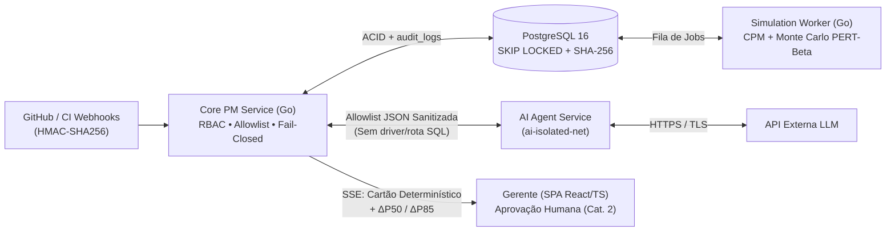

<div align="center">

# Sombra Digital Governada & IA para Apoio à Decisão em Projetos de Software

**Arquitetura de Referência com Simulação de Monte Carlo (PERT-Beta + Bernoulli), Método do Caminho Crítico e Governança Determinística *Fail-Closed***

[](Codigo/go.mod)
[](Codigo/extract_dataset.py)
[](Docs/Main.tex)
[-008C4F?style=flat-square)](#como-executar-a-poc-e-os-testes)
[-1D4B7C?style=flat-square)](Docs/Main.tex)

[Visão Geral](#visão-geral) •
[Arquitetura](#arquitetura-de-referência) •
[Prova de Conceito](#prova-de-conceito-poc-engine) •
[Execução Rápida](#como-executar-a-poc-e-os-testes) •
[Monografia Overleaf](#compilação-da-monografia-overleaf--latex) •
[Estrutura](#estrutura-do-repositório)

</div>

---

> **Trabalho de Conclusão de Curso (TCC 1) — Engenharia de Software**  
> **Instituição:** Universidade de Brasília (UnB) — Faculdade de Ciências e Tecnologias em Engenharia (FCTE)  
> **Autores:** Carlos Henrique de Souza Bispo • Paulo Henrique Virgilio Cerqueira  
> **Orientador:** Prof. Dr. Ricardo Matos Chaim

---

## Visão Geral

Projetos de software em ciclos iterativos ou híbridos sofrem com desvios de prazo causados pela desconexão entre eventos reais de engenharia (PRs, *issues*, falhas de CI) e modelos formais de precedência ($FS$), agravados pelo **viés de convergência de caminhos** ($E[\max(X,Y)] \ge \max(E[X], E[Y])$). Paralelamente, conectar LLMs diretamente a repositórios sem isolamento expõe o projeto a **Injeção Indireta de Prompt (OWASP LLM01)**, **Divulgação de Dados Sensíveis (LLM02:2025)**, **Tratamento Inseguro de Saída (LLM05:2025)**, **Agência Excessiva (LLM06:2025)** e **Consumo Ilimitado (LLM10:2025)**, além de divergências numéricas em sínteses estocásticas.

Este repositório reúne a especificação arquitetural, a monografia completa em LaTeX ([`Docs/Main.tex`](Docs/Main.tex)), os *scripts* auditáveis de dados/figuras e a **Prova de Conceito (`poc-engine`)** em **Go 1.22** de uma **Sombra Digital Governada de Processo** (taxonomia de Kritzinger):

- **Sincronização automatizada (Físico $\rightarrow$ Virtual):** ingestão idempotente de *webhooks* GitHub/CI com validação HMAC-SHA256, *debounce* configurável (30 s), regra de parametrização empírica em 3 níveis ($Q_{05}/\hat{m}_{\mathrm{HSM}}/Q_{95}$, casamento $Q_{10}/Q_{90}$ e *fallback* de *bootstrap*) e progresso híbrido (incluindo tratamento explícito de `not_planned` e PRs abandonados).
- **Motor Estocástico Determinístico (`poc-engine`):** ordenação topológica $\mathcal{O}(\lvert V\rvert+\lvert E\rvert)$, CPM exato e Simulação de Monte Carlo concorrente (PERT-Beta via Marsaglia-Tsang + riscos discretos de Bernoulli) com subfluxos independentes por par $(\text{iteração } k, \text{entidade})$ para comparação pareada via Números Aleatórios Comuns (CRN, redução de variância de `6,1x`), soma compensada de Kahan e cálculo de erro-padrão de Monte Carlo (MCSE).
- **Governança de IA *Fail-Closed*:** agente LLM em sub-rede isolada (`ai-isolated-net`) sem driver ou rota SQL, restrito a uma *allowlist* submetida a pipeline de sanitização Unicode NFKC em 5 estágios, verificador numérico pós-geração, classificador estático no servidor (Categorias 1 e 2 + negação por padrão), quarentena de `draft_risks` com máquina de estados completa (`DRAFT -> PENDING_APPROVAL -> APPROVED/REJECTED/STALE/EXPIRED`), cartão segregado com $\Delta P_{50}/\Delta P_{85}/\Delta \mathrm{IC}_i$, alerta simétrico de deriva (`±30%`) e trilha de auditoria encadeada por **SHA-256** com serialização no topo e ancoragem externa autenticada via **HMAC-SHA256** ou **Ed25519**.

---

## Arquitetura de Referência


<details>
<summary><strong>Ver fluxo completo Evento → Simulação → IA → Governança → Auditoria</strong></summary>



| Camada / Contêiner | Sub-rede Docker | Responsabilidade Central | Garantias Principais |
| :--- | :--- | :--- | :--- |
| **Core PM Service** (`Go`) | `core-net` + `ai-isolated-net` | Ingestão HMAC, construção da *allowlist*, classificação binária *fail-closed*, fila Cat. 2 e alertas (RF12) | Negação por padrão (`REJECTED`), verificação numérica ($\pm 0{,}05$ / $\pm 0{,}01$), RBAC |
| **PostgreSQL 16** | `core-net` | Estado versionado (`state_version`), cenários em `JSONB`, fila assíncrona e trilha de auditoria | `FOR UPDATE SKIP LOCKED`, `UPDATE`/`DELETE` revogados + cadeia SHA-256 ancorada |
| **Simulation Worker** (`Go`) | `core-net` | Execução concorrente de CPM + 10.000 iterações Monte Carlo com soma de Kahan e MCSE | Reprodutibilidade determinística por índice (1/4/16 *workers*) e latência `< 500 ms` (`RNF06`) |
| **AI Agent Service** | `ai-isolated-net` | Consome apenas métricas e títulos sanitizados (120/280 chars) e retorna JSON validado por *schema* | Sem `libpq`/`pgx`, sem credenciais SQL, sem código-fonte ou PII |

</details>

---

## Prova de Conceito (`poc-engine`)

O núcleo estocástico implementado em [`Codigo/`](Codigo/) valida as propriedades matemáticas e de desempenho da arquitetura usando apenas a biblioteca padrão do Go 1.22 (`module poc-engine`).


### Principais Resultados Verificados

| Validação | Configuração / Escopo | Resultado Medido | Requisito |
| :--- | :--- | :--- | :--- |
| **Viés de Convergência (Cenário A)** | Rede 4 tarefas (Figura 1), $N=10.000$, seed `42` | CPM = `10,83` d.u. vs. Média `11,44 (±0,013)`, $P_{50}=11{,}39\text{ (±0,018)}$ / $P_{85}=12{,}75\text{ (±0,020)}$ d.u. | RQ2, RF06 |
| **Impacto de Mitigação c/ CRN (C vs. C$'$)** | Status $t_s=5$, risco R1 ($p_r=0{,}30, \Delta_r=2$) mitigado | $\Delta\bar{F}=-0{,}37\text{ (±0,0059)}$ d.u. (redução de variância de **`6,1x`**); $\Delta P_{85}=-0{,}57\text{ (±0,018)}$ d.u.; $\mathrm{IC}_{\mathrm{T3}}$ cai de `78,4%` para `69,3%` | RF09, RQ2 |
| **Teste KS PERT-Beta ($n=10^6$ + 100 seeds)** | `ComputeKSBetaFit` ($D_{\mathrm{crit},0{,}05}=0{,}00136$) + `RunKSMultiSeedSuite` | $H_0$ não rejeitada em T1–T4 ($D_n \in [0{,}00052;\, 0{,}00131]$, $p \in [0{,}065;\, 0{,}947]$; taxa de rejeição em 100 seeds: `3%–8%`, média `5,0%`) | RQ2 |
| **Caso Degenerado ($t_o=t_m=t_p$)** | `TestDegeneratePertBetaZeroVariance` `(5, 5, 5)` | Duração exata `5,00000`, variância `0,00000`, zero `NaN` | RQ2 |
| **Reprodutibilidade por Índice** | `TestReproducibilityAcrossWorkers` (1, 4 e 16 *workers*) | Variação `0,000000` em Média Kahan (`11,899335`), $P_{50}, P_{85}, P_{95}$, $P(F\le 11)$ e $\mathrm{IC}_{\mathrm{T3}}$ | RNF08 |
| **Escalabilidade (200 tarefas / 300 deps)** | Rede sintética em camadas ($N=10.000$, 1/2/4/8 *workers*, 5 rep.) | Mediana **`61,00 ms`** (8 *workers*), **`61,71 ms`** (4 *workers*, speedup `3,95x`), **`125,61 ms`** (2 *workers*) e **`243,86 ms`** (1 *worker*) | RNF06 |
| **Cronograma Pré-Registrado TCC 2** | `AuditTCC2Schedule` (14 pacotes essenciais, 08/03/2027 a 23/07/2027) | Nominal c/ riscos: $P_{50}=17{,}29$, $P_{85}=18{,}30$ sem. ($P(F\le 20)=99{,}6\%$); Estresse `+25%` + cortes pré-registrados: $P_{85}=19{,}82 \le 20{,}0$ sem. | Cap. 6 |
| **Poder Estatístico TOST (H1b)** | `power_h1b.py` ($M=500$ grafos/regime, IC Wilson 90% em $[80\%,90\%]$) | Poder exato de **`86,2%`** em $p=0{,}85$ (`52,7%` em $p=0{,}83$; `67,0%` em $p=0{,}87$) | RQ4, Cap. 3 |

<details>
<summary><strong>Ver tabelas detalhadas: Cenários A–C′ (com MCSE) e Teste Kolmogorov-Smirnov (10⁶ amostras)</strong></summary>

#### Cenários da PoC ($N = 10.000$, semente `42`, meta $F \le 11{,}0$ d.u.)

| Cenário | CPM ($F$) | Média ($\pm$MCSE) | $P_{50}$ ($\pm$MCSE) | $P_{85}$ ($\pm$MCSE) | $P_{95}$ ($\pm$MCSE) | $P(F \le 11)$ | $\mathrm{IC}_{\mathrm{T2}}$ | $\mathrm{IC}_{\mathrm{T3}}$ |
| :--- | :---: | :---: | :---: | :---: | :---: | :---: | :---: | :---: |
| **A.** Início do projeto, sem riscos | 10,83 | 11,44 (±0,013) | 11,39 (±0,018) | 12,75 (±0,020) | 13,64 (±0,033) | 38,3% | 51,1% | 48,9% |
| **B.** Início, com R1 em T3 | 10,83 | 11,89 (±0,015) | 11,79 (±0,018) | 13,43 (±0,028) | 14,55 (±0,035) | 29,4% | 38,7% | 61,3% |
| **C.** Status $t_s=5$, R1 ativo ($s_{r,3}=0{,}70$) | 11,02 | 11,58 (±0,011) | 11,47 (±0,014) | 12,77 (±0,020) | 13,55 (±0,031) | 32,2% | 21,6% | 78,4% |
| **C$'$**. Como C, com R1 mitigado | 11,02 | 11,21 (±0,009) | 11,14 (±0,010) | 12,20 (±0,016) | 12,89 (±0,024) | 43,3% | 30,7% | 69,3% |

#### Momentos Analíticos e Teste de Aderência Kolmogorov-Smirnov (`validation_test.go`)

| Tarefa / Caso | $\mu$ analítica | $\mu$ amostral | $\sigma^2$ analítica | $\sigma^2$ amostral | $D_n$ exato ($10^6$) | $p$-valor ($10^6$) | Rejeições (100 seeds) |
| :--- | :---: | :---: | :---: | :---: | :---: | :---: | :---: |
| **T1** `(2, 3, 5)` | 3,167 | 3,167 | 0,306 | 0,306 | `0,00052` (`< 0,00136`) | `p = 0,947` | `4/100 (4%)` |
| **T2** `(4, 5, 9)` | 5,500 | 5,501 | 0,750 | 0,751 | `0,00099` (`< 0,00136`) | `p = 0,280` | `5/100 (5%)` |
| **T3** `(3, 5, 10)` | 5,500 | 5,502 | 1,607 | 1,609 | `0,00131` (`< 0,00136`) | `p = 0,065` | `3/100 (3%)` |
| **T4** `(1, 2, 4)` | 2,167 | 2,165 | 0,306 | 0,305 | `0,00116` (`< 0,00136`) | `p = 0,135` | `8/100 (8%)` |
| **Degenerado** `(5, 5, 5)` | 5,000 | 5,000 | 0,000 | 0,000 | `0,00000` (Exato) | `--- (massa pontual)` | `0/100 (0%)` |

</details>

---

## Como Executar a PoC e os Testes

### Pré-requisitos
- **Go 1.22+** (zero dependências externas no pacote `poc-engine`)
- **Python 3.11+** (`extract_dataset.py`, `power_h1b.py`, `pilot_backtesting.py`, `check_numbers.py` e `check_latex.py` usam apenas biblioteca padrão; `generate_figures.py` usa `numpy`, `matplotlib` e `pillow`)

### Comandos

```bash
# 1. Executar a simulação dos Cenários A–C' e do Cronograma TCC 2 (exporta poc_results.json, Docs/resultados_poc.tex e Docs/tabelas/*.tex)
cd Codigo
go run .

# 2. Rodar toda a suíte de validação com cobertura (94,2% de cobertura de instruções)
go test -v -count=1 -cover ./...

# 3. Rodar os benchmarks de desempenho e alocações em 5 repetições (RNF06)
go test -bench=Benchmark -benchmem -count=5
```

```bash
# 4. Executar o estudo de poder estatístico TOST (H1b), verificar dataset local, rodar o piloto da Dimensão 3 e regenerar figuras PNG
cd Codigo
python power_h1b.py
python extract_dataset.py --verify-local
python pilot_backtesting.py
python generate_figures.py

# 5. Executar auditoria automatizada de sincronia numérica e integridade LaTeX/BibTeX
cd ..
python Codigo/check_numbers.py
python Codigo/check_latex.py
```

| Módulo / Script | Função Principal | Observação |
| :--- | :--- | :--- |
| [`Codigo/model.go`](Codigo/model.go) | `Task`, `Dependency`, `Risk`, `ValidateNetwork`, `CRNDiffResult` | Contratos tipados e validação defensiva de grafos e parâmetros |
| [`Codigo/random.go`](Codigo/random.go) | `SplitMix64`, `SampleGamma`, `SamplePERTBeta`, `ComputeKSBetaFit`, `RunKSMultiSeedSuite` | Amostragem Marsaglia-Tsang, CDF Beta (Lentz) e teste KS ($10^6$ + 100 seeds) |
| [`Codigo/cpm.go`](Codigo/cpm.go) | `TopologicalSort`, `CompileGraph`, `FastCPM`, `CalculateExpectedDurationWithLambda` | Ordenação $\mathcal{O}(\lvert V\rvert+\lvert E\rvert)$ e CPM parametrizado por $\lambda$ |
| [`Codigo/simulator.go`](Codigo/simulator.go) | `RunMonteCarlo`, `ComputeCRNDiff` | Orquestrador concorrente livre de *false sharing* e avaliador pareado CRN |
| [`Codigo/validation_test.go`](Codigo/validation_test.go) | `TestPertBetaKSMultiSeed100`, `TestSplitMix64StreamIndependence`, `TestTCC2ScheduleMonteCarlo` | Suíte completa de validação com `94,2%` de cobertura |
| [`Codigo/extract_dataset.py`](Codigo/extract_dataset.py) | Extração de janelas de *release* via API GitHub + vetores itemizados | Inclui sensibilidade ao piso `{0,10; 0,25; 0,50}` d.u. e `--verify-local` |
| [`Codigo/pilot_backtesting.py`](Codigo/pilot_backtesting.py) | Piloto executável da Dimensão 3 (regra em 3 níveis + replay causal) | Exporta `pilot_backtesting_results.json` e `tab_piloto_backtesting.tex` |
| [`Codigo/power_h1b.py`](Codigo/power_h1b.py) | Estudo de poder estatístico binomial exato para H1b (TOST 90%) | Demonstra poder de `86,2%` para $M=500$ vs `0,0%` para $M=200$ (IC 95%) |
| [`Codigo/check_numbers.py`](Codigo/check_numbers.py) | Verificador automatizado de consistência numérica JSON $\leftrightarrow$ LaTeX | Impede *drift* manual de números entre `poc-engine` e a monografia |
| [`Codigo/check_latex.py`](Codigo/check_latex.py) | Verificador estrutural de LaTeX, citações BibTeX e logs de compilação | Garante zero referências indefinidas, zero entradas órfãs e zero erros |

---

## Compilação da Monografia (Overleaf / LaTeX)

A monografia completa no padrão **abnTeX2** encontra-se em [`Docs/Main.tex`](Docs/Main.tex) com bibliografia em [`Docs/Referencias.bib`](Docs/Referencias.bib) (cópia em minúsculo na raiz em [`referencias.bib`](referencias.bib)).

> [!TIP]
> **Para compilar sem *timeout* no plano gratuito do Overleaf (limite de 10 s):**
> 1. Envie [`Docs/Main.tex`](Docs/Main.tex) como `main.tex`, [`Docs/Referencias.bib`](Docs/Referencias.bib) como `referencias.bib`, [`Docs/resultados_poc.tex`](Docs/resultados_poc.tex) e [`Docs/capa_fundo.png`](Docs/capa_fundo.png) na raiz do projeto Overleaf.
> 2. Envie a pasta [`Docs/tabelas/`](Docs/tabelas/) (contendo os 7 fragmentos `.tex` gerados automaticamente) e as 8 imagens de [`Docs/figuras/`](Docs/figuras/) para as subpastas `tabelas/` e `figuras/` no Overleaf — as imagens já estão otimizadas em **PNG 8-bit RGB opaco sem canal alfa**, permitindo cópia direta rápida no `pdflatex` e pulando o carregamento do TikZ.
> 3. Caso atualize o código `.tex`, limpe o cache (*Logs and output files* $\rightarrow$ lixeira *Clear cached files*) antes de recompilar.

---

## Estrutura do Repositório

```text
TCC-01/
├── Codigo/
│   ├── go.mod                           # Módulo poc-engine (Go 1.22+, zero deps externas)
│   ├── model.go                         # Estruturas da rede DAG, validação e CRN
│   ├── random.go                        # SplitMix64, Gamma, PERT-Beta e KS (10^6 + 100 seeds)
│   ├── cpm.go                           # Ordenação topológica (Kahn) e FastCPM zero-alloc
│   ├── simulator.go                     # Motor concorrente de Monte Carlo e ComputeCRNDiff
│   ├── main.go                          # Runner + exportador automático JSON e tabelas LaTeX
│   ├── engine_test.go                   # Testes unitários, validação de entrada, CRN e RNF08
│   ├── validation_test.go               # Momentos, KS multi-seed, TCC2 estresse/cortes e benchmarks
│   ├── power_h1b.py                     # Cálculo binomial exato de poder estatístico TOST (H1b)
│   ├── extract_dataset.py               # Coleta reprodutível via API do GitHub (cli/cli)
│   ├── dataset_backtesting.json         # Snapshot itemizado e pseudonimizado de v2.39.2 a v2.46.0
│   ├── pilot_backtesting.py             # Piloto executável da regra em 3 níveis (Dimensão 3)
│   ├── generate_figures.py              # Gerador estático das 8 figuras PNG (RGB 200 DPI)
│   ├── check_numbers.py                 # Verificador de sincronia numérica JSON <-> LaTeX
│   └── check_latex.py                   # Verificador de integridade LaTeX e BibTeX
├── Docs/
│   ├── Main.tex                         # Monografia completa do TCC 1 (abnTeX2, Cap. 1-6 + Apêndices)
│   ├── Referencias.bib                  # 50 referências auditadas compatíveis com abntex2cite
│   ├── resultados_poc.tex               # Macros LaTeX geradas automaticamente por Codigo/main.go
│   ├── tabelas/                         # 7 fragmentos LaTeX gerados por main.go e pilot_backtesting.py
│   ├── figuras/                         # Cópias das 8 figuras PNG usadas pelo Main.tex
│   ├── adr/                             # 7 Architecture Decision Records (ADR-001 a ADR-007)
│   ├── bib_audit.md                     # Relatório de auditoria primária das 50 referências .bib
│   ├── baseline/                        # Logs de baseline pré-correções
│   └── legado/                          # Rascunhos históricos arquivados
├── tabelas/                             # Espelho dos fragmentos LaTeX na raiz
├── figuras/                             # Espelho das 8 figuras PNG geradas na raiz
├── CONSTRAINTS.md                       # Contrato de qualidade (C1–C9) e invariantes verificáveis
├── SPEC_CORRECAO_TCC1.md                # Especificação consolidada dos pareceres (CL, CX, AR)
├── tasks/                               # Plano de execução (plan.md) e rastreabilidade (todo.md)
└── README.md                            # Documentação principal do projeto
```
