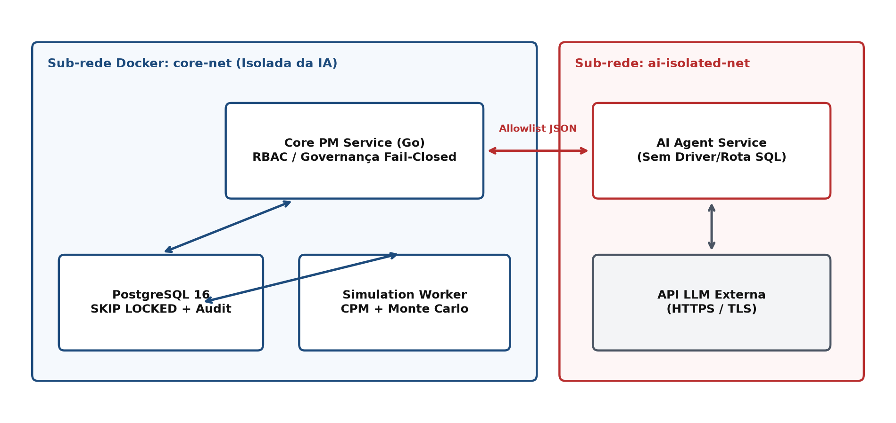
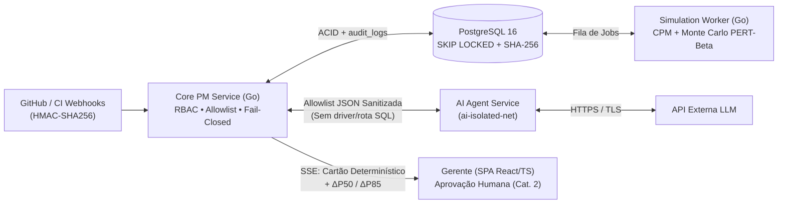
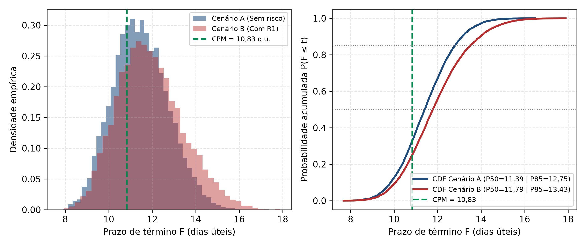

<div align="center">

# Sombra Digital Governada & IA para Apoio à Decisão em Projetos de Software

**Arquitetura de Referência com Simulação de Monte Carlo (PERT-Beta + Bernoulli), Método do Caminho Crítico e Governança Determinística *Fail-Closed***

[](Codigo/go.mod)
[](Codigo/extract_dataset.py)
[](Docs/Main.tex)
[-008C4F?style=flat-square)](#como-executar-a-poc-e-os-testes)
[-1D4B7C?style=flat-square)](Docs/Main.tex)

[Visão Geral](#visão-geral) •
[Arquitetura](#arquitetura-de-referência) •
[Prova de Conceito](#prova-de-conceito-poc-engine) •
[Execução Rápida](#como-executar-a-poc-e-os-testes) •
[Monografia Overleaf](#compilação-da-monografia-overleaf--latex) •
[Estrutura](#estrutura-do-repositório)

</div>

---

> **Trabalho de Conclusão de Curso (TCC 1) — Engenharia de Software**  
> **Instituição:** Universidade de Brasília (UnB) — Faculdade de Ciências e Tecnologias em Engenharia (FCTE)  
> **Autores:** Carlos Henrique de Souza Bispo • Paulo Henrique Virgilio Cerqueira  
> **Orientador:** Prof. Dr. Ricardo Matos Chaim

---

## Visão Geral

Projetos de software em ciclos iterativos ou híbridos sofrem com desvios crônicos de prazo causados pela desconexão entre eventos reais de engenharia (PRs, *issues*, falhas de CI) e modelos formais de precedência ($FS$), agravados pelo **viés de convergência de caminhos** ($E[\max(X,Y)] \ge \max(E[X], E[Y])$). Paralelamente, conectar LLMs diretamente a repositórios sem isolamento expõe o projeto a **Injeção Indireta de Prompt (OWASP LLM01)**, **Divulgação de Dados Sensíveis (LLM02:2025)** e **Agência Excessiva (LLM06:2025)**, além de alucinações numéricas.

Este repositório reúne a especificação arquitetural, a monografia completa em LaTeX ([`Docs/Main.tex`](Docs/Main.tex)), os *scripts* auditáveis de dados/figuras e a **Prova de Conceito (`poc-engine`)** em **Go 1.22** de uma **Sombra Digital Governada de Processo** (taxonomia de Kritzinger):

- **Sincronização automatizada (Físico $\rightarrow$ Virtual):** ingestão idempotente de *webhooks* GitHub/CI com validação HMAC-SHA256, *debounce* configurável (30 s) e progresso híbrido (incluindo tratamento explícito de `not_planned` e PRs abandonados).
- **Motor Estocástico Determinístico (`poc-engine`):** ordenação topológica $\mathcal{O}(\lvert V\rvert+\lvert E\rvert)$, CPM exato e Simulação de Monte Carlo concorrente (PERT-Beta via Marsaglia-Tsang + riscos discretos de Bernoulli) com reprodutibilidade bit a bit via `SplitMix64(S0 ^ k)`.
- **Governança de IA *Fail-Closed*:** agente LLM em sub-rede isolada (`ai-isolated-net`) sem driver ou rota SQL, restrito a uma *allowlist* sanitizada, classificador estático no servidor (Categorias 1 e 2 + negação por padrão), quarentena de `draft_risks`, cartão anti-persuasão com $\Delta P_{50}/\Delta P_{85}/\Delta \mathrm{IC}_i$ e trilha de auditoria encadeada por **SHA-256** com ancoragem externa **WORM**.

---

## Arquitetura de Referência



<details>
<summary><strong>Ver fluxo completo Evento → Simulação → IA → Governança → Auditoria</strong></summary>



| Camada / Contêiner | Sub-rede Docker | Responsabilidade Central | Garantias Principais |
| :--- | :--- | :--- | :--- |
| **Core PM Service** (`Go`) | `core-net` + `ai-isolated-net` | Ingestão HMAC, construção da *allowlist*, classificação binária *fail-closed*, fila Cat. 2 e alertas (RF12) | Negação por padrão (`REJECTED`), verificação numérica ($\le 10^{-2}$), RBAC |
| **PostgreSQL 16** | `core-net` | Estado versionado (`state_version`), cenários em `JSONB`, fila assíncrona e trilha de auditoria | `FOR UPDATE SKIP LOCKED`, `UPDATE`/`DELETE` revogados + cadeia SHA-256 ancorada |
| **Simulation Worker** (`Go`) | `core-net` | Execução concorrente de CPM + 10.000 iterações Monte Carlo sem alocação no laço interno | Reprodutibilidade bit a bit (1/4/16 *workers*) e latência sub-segundo (`RNF06`) |
| **AI Agent Service** | `ai-isolated-net` | Consome apenas métricas e títulos sanitizados (120/280 chars) e retorna JSON validado por *schema* | Sem `libpq`/`pgx`, sem credenciais SQL, sem código-fonte ou PII |

</details>

---

## Prova de Conceito (`poc-engine`)

O núcleo estocástico implementado em [`Codigo/`](Codigo/) valida as propriedades matemáticas e de desempenho da arquitetura usando apenas a biblioteca padrão do Go 1.22 (`module poc-engine`).



### Principais Resultados Verificados

| Validação | Configuração / Escopo | Resultado Medido | Requisito |
| :--- | :--- | :--- | :--- |
| **Viés de Convergência (Cenário A)** | Rede 4 tarefas (Figura 1), $N=10.000$, seed `42` | CPM = `10,83` d.u. vs. $P_{50}=11{,}39$ / $P_{85}=12{,}75$ d.u. ($38{,}3\%$ de cumprir meta $\le 11$) | RQ2, RF06 |
| **Impacto de Mitigação (C vs. C$'$)** | Status $t_s=5$, risco R1 ($p_r=0{,}30, \Delta_r=2$) mitigado | $P_{85}$ cai de `12,77` para `12,20` d.u. ($\Delta P_{85}=-0{,}57$); $\mathrm{IC}_{\mathrm{T3}}$ cai de `78,4%` para `69,3%` | RF09, RQ2 |
| **Teste KS PERT-Beta ($n=10^6$)** | `TestPertBetaKSGoodnessOfFit` ($D_{\mathrm{crit},0{,}05}=0{,}00136$) | Todas as tarefas T1–T4 aceitas ($D_n \in [0{,}00051;\, 0{,}00130]$, $p \in [0{,}068;\, 0{,}958]$) | RQ2 |
| **Caso Degenerado ($t_o=t_m=t_p$)** | `TestDegeneratePertBetaZeroVariance` `(5, 5, 5)` | Duração exata `5,00000`, variância `0,00000`, zero `NaN` | RQ2 |
| **Reprodutibilidade Concorrente** | `TestReproducibilityAcrossWorkers` (1, 4 e 16 *workers*) | Variação máxima `0,000000` em $P_{50}, P_{85}, P_{95}$, $P(F\le 11)$ e $\mathrm{IC}_{\mathrm{T3}}$ | RNF08 |
| **Desempenho (1 vCPU Linux AMD64)** | Rede sintética 200 tarefas / 300 deps / 40 riscos (5 runs) | Mediana **`259,6 ms`** (`260,4 ± 4,12 ms`), **`38.520 it/s`**, folga **`3,9x`** abaixo de `1,0 s` | RNF06 |

<details>
<summary><strong>Ver tabelas detalhadas: Cenários A–C′ e Teste Kolmogorov-Smirnov (10⁶ amostras)</strong></summary>

#### Cenários da PoC ($N = 10.000$, semente `42`, meta $F \le 11{,}0$ d.u.)

| Cenário | CPM ($F$) | $P_{50}$ | $P_{85}$ | $P_{95}$ | $P(F \le 11)$ | $\mathrm{IC}_{\mathrm{T2}}$ | $\mathrm{IC}_{\mathrm{T3}}$ |
| :--- | :---: | :---: | :---: | :---: | :---: | :---: | :---: |
| **A.** Início do projeto, sem riscos | 10,83 | 11,39 | 12,75 | 13,64 | 38,3% | 51,1% | 48,9% |
| **B.** Início, com R1 em T3 | 10,83 | 11,79 | 13,43 | 14,55 | 29,4% | 38,7% | 61,3% |
| **C.** Status $t_s=5$, R1 ativo ($s_{r,3}=0{,}70$) | 11,02 | 11,47 | 12,77 | 13,55 | 32,2% | 21,6% | 78,4% |
| **C$'$**. Como C, com R1 mitigado | 11,02 | 11,14 | 12,20 | 12,89 | 43,3% | 30,7% | 69,3% |

#### Momentos Analíticos e Teste de Aderência Kolmogorov-Smirnov (`validation_test.go`)

| Tarefa / Caso | $\mu$ analítica | $\mu$ amostral | $\sigma^2$ analítica | $\sigma^2$ amostral | Estatística KS ($D_n$) | *p-valor* KS |
| :--- | :---: | :---: | :---: | :---: | :---: | :---: |
| **T1** `(2, 3, 5)` | 3,16667 | 3,16628 | 0,30556 | 0,30549 | `0,00051` (`< 0,00136`) | `0,958` (Aceito) |
| **T2** `(4, 5, 9)` | 5,50000 | 5,50073 | 0,75000 | 0,75055 | `0,00098` (`< 0,00136`) | `0,291` (Aceito) |
| **T3** `(3, 5, 10)` | 5,50000 | 5,49985 | 1,60714 | 1,60472 | `0,00130` (`< 0,00136`) | `0,068` (Aceito) |
| **T4** `(1, 2, 4)` | 2,16667 | 2,16628 | 0,30556 | 0,30549 | `0,00114` (`< 0,00136`) | `0,146` (Aceito) |
| **Degenerado** `(5, 5, 5)` | 5,00000 | 5,00000 | 0,00000 | 0,00000 | `0,00000` (Exato) | `1,000` (Aceito) |

</details>

---

## Como Executar a PoC e os Testes

### Pré-requisitos
- **Go 1.22+** (zero dependências externas no pacote `poc-engine`)
- **Python 3.11+** (`extract_dataset.py` usa apenas biblioteca padrão; `generate_figures.py` usa `numpy`, `matplotlib` e `pillow`)

### Comandos

```bash
# 1. Executar a simulação dos Cenários A, B, C e C' (exporta poc_results.json)
cd Codigo
go run .

# 2. Rodar toda a suíte de validação (ciclos, CPM, momentos, teste KS, degenerado e RNF08)
go test -v -count=1 ./...

# 3. Rodar os benchmarks de desempenho e alocações em 5 repetições (RNF06)
go test -bench=Benchmark -benchmem -count=5
```

```bash
# 4. Regenerar as 8 figuras PNG (RGB opaco 200 DPI otimizado para pdflatex/Overleaf)
python Codigo/generate_figures.py

# 5. Reextrair métricas históricas das janelas de release do GitHub CLI (cli/cli)
python Codigo/extract_dataset.py --repo cli/cli --out Codigo/dataset_backtesting.json
```

| Módulo / Script | Função Principal | Observação |
| :--- | :--- | :--- |
| [`Codigo/model.go`](Codigo/model.go) | `Task`, `Dependency`, `Risk`, `ProjectNetwork`, `MonteCarloResult` | Contratos tipados da rede de precedências e saída |
| [`Codigo/random.go`](Codigo/random.go) | `SplitMix64`, `SampleGamma`, `SamplePERTBeta`, `SampleBernoulli` | Amostragem Marsaglia-Tsang + guarda `tp - to <= 1e-12` |
| [`Codigo/cpm.go`](Codigo/cpm.go) | `TopologicalSort`, `CompileGraph`, `FastCPM`, `SolveCPM` | Ordenação $\mathcal{O}(\lvert V\rvert+\lvert E\rvert)$ e CPM sem alocações no laço |
| [`Codigo/simulator.go`](Codigo/simulator.go) | `RunMonteCarlo` | Orquestrador concorrente independente da ordem das *goroutines* |
| [`Codigo/validation_test.go`](Codigo/validation_test.go) | `TestPertBetaKSGoodnessOfFit`, `TestBenchmarkDispersion5Runs` | CDF Beta regularizada (Lentz), caso degenerado e 5 repetições |
| [`Codigo/extract_dataset.py`](Codigo/extract_dataset.py) | Extração de janelas de *release* via API GitHub | Separa `reason:completed` de `not_planned` e `is:unmerged` |

---

## Compilação da Monografia (Overleaf / LaTeX)

A monografia completa no padrão **abnTeX2** encontra-se em [`Docs/Main.tex`](Docs/Main.tex) com bibliografia em [`Docs/Referencias.bib`](Docs/Referencias.bib) (cópia em minúsculo na raiz em [`referencias.bib`](referencias.bib)).

> [!TIP]
> **Para compilar sem *timeout* no plano gratuito do Overleaf (limite de 10 s):**
> 1. Envie [`Docs/Main.tex`](Docs/Main.tex) como `main.tex`, [`Docs/Referencias.bib`](Docs/Referencias.bib) como `referencias.bib` e [`Docs/capa_fundo.png`](Docs/capa_fundo.png) na raiz do projeto Overleaf.
> 2. Envie as 8 imagens de [`Docs/figuras/`](Docs/figuras/) para uma subpasta `figuras/` no Overleaf — elas já estão otimizadas em **PNG 8-bit RGB opaco sem canal alfa**, permitindo cópia direta rápida no `pdflatex` e pulando o carregamento do TikZ.
> 3. Caso atualize o código `.tex`, limpe o cache (*Logs and output files* $\rightarrow$ lixeira *Clear cached files*) antes de recompilar.

---

## Estrutura do Repositório

```text
TCC-01/
├── Codigo/
│   ├── go.mod                        # Módulo poc-engine (Go 1.22, zero deps externas)
│   ├── model.go                      # Estruturas da rede DAG, riscos e resultados
│   ├── random.go                     # SplitMix64, Gamma (Marsaglia-Tsang) e PERT-Beta
│   ├── cpm.go                        # Ordenação topológica (Kahn) e FastCPM zero-alloc
│   ├── simulator.go                  # Motor concorrente de Monte Carlo
│   ├── main.go                       # Runner dos Cenários A, B, C e C'
│   ├── engine_test.go                # Testes unitários, RNF08 e benchmarks (4 e 200 tarefas)
│   ├── validation_test.go            # Momentos, teste KS (10^6), degenerado e dispersão
│   ├── extract_dataset.py            # Coleta reprodutível via API do GitHub (cli/cli)
│   ├── dataset_backtesting.json      # Snapshot congelado de v2.39.2 a v2.46.0
│   └── generate_figures.py           # Gerador estático das 8 figuras PNG (RGB 200 DPI)
├── Docs/
│   ├── Main.tex                      # Monografia completa do TCC 1 (abnTeX2, Cap. 1-6 + Apêndices)
│   ├── Referencias.bib               # Referências bibliográficas compatíveis com abntex2cite
│   ├── capa_fundo.png                # Arte de fundo da capa (suporta também capa_fundo.jpg)
│   ├── proposta_tcc1_revisada_v6.md  # Versão de referência em Markdown da proposta
│   └── figuras/                      # Cópias das 8 figuras PNG usadas pelo Main.tex
├── figuras/                          # Espelho das 8 figuras PNG geradas na raiz
├── referencias.bib                   # Cópia em minúsculo para sistemas case-sensitive
├── tasks/                            # Plano de correções e checklist da banca
└── README.md                         # Documentação principal do projeto
```
