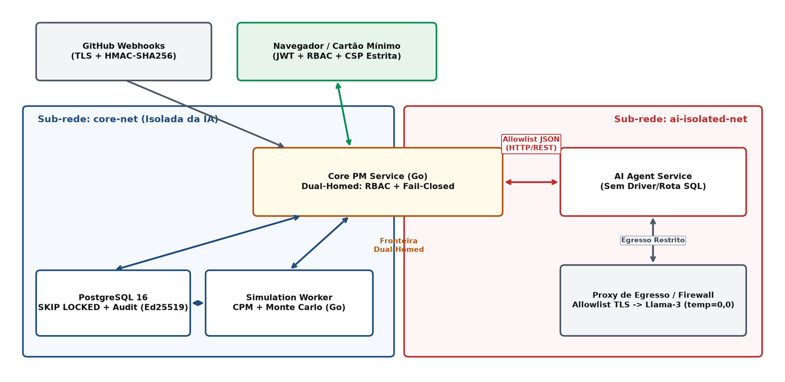
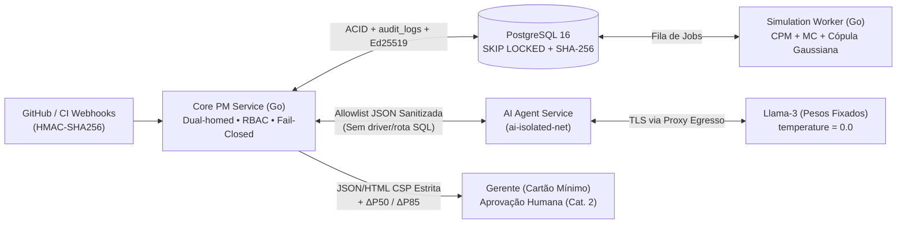
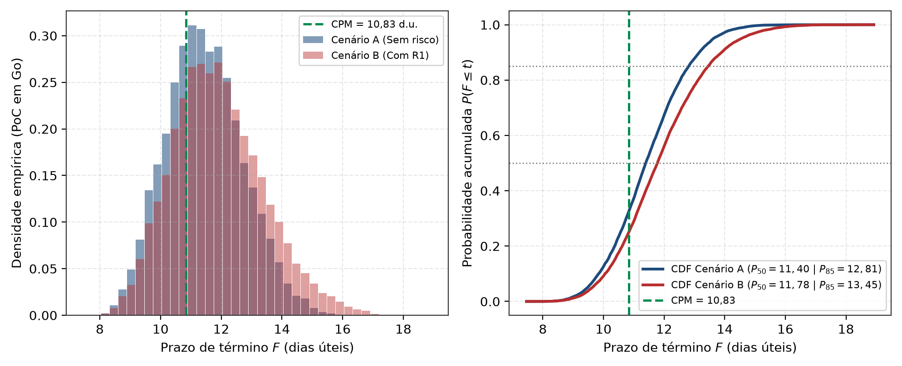

<div align="center">

# Sombra Digital Governada & IA para Apoio à Decisão em Projetos de Software

**Arquitetura Proposta com Simulação de Monte Carlo (PERT-Beta + Bernoulli + Cópula Gaussiana), Método do Caminho Crítico e Governança Determinística *Fail-Closed***

[](Codigo/poc-engine/go.mod)
[](Codigo/scripts/extract_dataset.py)
[](Docs/monografia/Main.tex)
[-008C4F?style=flat-square)](#como-executar-a-poc-e-os-testes)
[-1D4B7C?style=flat-square)](Docs/monografia/Main.tex)

[Visão Geral](#visão-geral) •
[Arquitetura](#arquitetura-proposta) •
[Prova de Conceito](#prova-de-conceito-poc-engine) •
[Execução Rápida](#como-executar-a-poc-e-os-testes) •
[Monografia Overleaf](#compilação-da-monografia-overleaf--latex) •
[Estrutura](#estrutura-do-repositório)

</div>

---

> **Trabalho de Conclusão de Curso (TCC 1) — Engenharia de Software**  
> **Instituição:** Universidade de Brasília (UnB) — Faculdade de Ciências e Tecnologias em Engenharia (FCTE)  
> **Autores:** Carlos Henrique de Souza Bispo • Paulo Henrique Virgilio Cerqueira  
> **Orientador:** Prof. Dr. Ricardo Matos Chaim

---

## Visão Geral

Projetos de software em ciclos iterativos ou híbridos sofrem com desvios de prazo causados pela desconexão entre eventos reais de engenharia (PRs, *issues*, falhas de CI) e modelos formais de precedência ($FS$), agravados pelo **viés de convergência de caminhos** ($E[\max(X,Y)] \ge \max(E[X], E[Y])$). Paralelamente, conectar LLMs diretamente a repositórios sem isolamento expõe o projeto a **Injeção Indireta de Prompt (OWASP LLM01)**, **Divulgação de Dados Sensíveis (LLM02:2025)**, **Tratamento Inseguro de Saída (LLM05:2025)**, **Agência Excessiva (LLM06:2025)** e **Consumo Ilimitado (LLM10:2025)**, além de divergências numéricas em sínteses estocásticas.

Este repositório reúne a especificação arquitetural, a monografia completa em LaTeX ([`Docs/monografia/Main.tex`](Docs/monografia/Main.tex)), os *scripts* auditáveis de dados/figuras e a **Prova de Conceito (`poc-engine`)** em **Go 1.27** de uma **Sombra Digital Governada de Processo** (taxonomia de Kritzinger):

- **Sincronização automatizada (Físico $\rightarrow$ Virtual):** ingestão idempotente de *webhooks* GitHub/CI com validação HMAC-SHA256 (RFC 2104), *debounce* configurável (30 s), regra de parametrização empírica em 2 níveis ($Q_{05}/\hat{m}_{\mathrm{HSM}}/Q_{95}$ ou *fallback* de *bootstrap* empírico) e progresso híbrido (incluindo tratamento explícito de `not_planned`, atribuição de *issues*, histórico pré-*squash* e PRs abandonados).
- **Motor Estocástico Determinístico (`poc-engine`):** ordenação topológica $\mathcal{O}(\lvert V\rvert+\lvert E\rvert)$, CPM exato e Simulação de Monte Carlo concorrente (PERT-Beta via Marsaglia-Tsang, riscos discretos de Bernoulli e cópula gaussiana) com derivação não comutativa `Mix64` + subfluxos independentes por par $(\text{iteração } k, \text{entidade})$ para comparação pareada via Números Aleatórios Comuns (CRN, redução de variância de `6,3x`), soma compensada de Kahan e cálculo de erro-padrão de Monte Carlo (MCSE).
- **Governança de IA *Fail-Closed*:** modelo de pesos abertos único da família Llama-3 (`temperature = 0.0`) em sub-rede isolada (`ai-isolated-net`) sem driver ou rota SQL (mediado pelo `Core PM Service` *dual-homed* e por *proxy* egresso com *allowlist* TLS), restrito a uma *allowlist* submetida a pipeline de sanitização Unicode NFKC em 5 estágios, verificador numérico pós-geração, classificador estático no servidor (Categorias 1 e 2 + negação por padrão), quarentena de `draft_risks` com máquina de estados completa (`DRAFT -> PENDING_APPROVAL -> APPROVED/REJECTED/STALE/EXPIRED`), cartão mínimo de aprovação com pré-visualização segregada de $\Delta P_{50}/\Delta P_{85}/\Delta \mathrm{IC}_i$ e CSP estrita, alerta simétrico de deriva (`±30%`) e trilha de auditoria encadeada por **SHA-256** isolada por projeto (`UNIQUE (project_id, prev_hash)`) com ancoragem externa assinada exclusivamente via **Ed25519 (RFC 8032)**.

---

## Arquitetura Proposta



<details>
<summary><strong>Ver fluxo completo Evento → Simulação → IA → Governança → Auditoria</strong></summary>



| Camada / Contêiner | Sub-rede Docker | Responsabilidade Central | Garantias Principais |
| :--- | :--- | :--- | :--- |
| **Core PM Service** (`Go`) | `core-net` + `ai-isolated-net` (*dual-homed*) | Ingestão HMAC, construção da *allowlist*, classificação binária *fail-closed*, fila Cat. 2 e âncora Ed25519 | Negação por padrão (`REJECTED`), verificação numérica ($\pm 0{,}05$ / $\pm 0{,}01$), RBAC |
| **PostgreSQL 16** | `core-net` | Estado versionado (`state_version`), cenários em `JSONB`, fila assíncrona e trilha de auditoria | `FOR UPDATE SKIP LOCKED`, `UPDATE`/`DELETE` revogados + cadeia SHA-256 por projeto |
| **Simulation Worker** (`Go`) | `core-net` | Execução concorrente de CPM + 10.000 iterações Monte Carlo com soma de Kahan e MCSE | Reprodutibilidade determinística por índice (1/4/16 *workers*) e latência `< 500 ms` (`RNF06`) |
| **AI Agent Service** | `ai-isolated-net` | Consome apenas métricas e títulos sanitizados (120/280 chars) via Llama-3 (`t=0.0`) e retorna JSON validado por *schema* | Sem `libpq`/`pgx`, sem credenciais SQL, sem código-fonte ou PII, egress TLS restrito |

</details>

---

## Prova de Conceito (`poc-engine`)

O núcleo estocástico implementado em [`Codigo/poc-engine/`](Codigo/poc-engine/) valida as propriedades matemáticas e de desempenho da arquitetura usando apenas a biblioteca padrão do Go 1.27 (`module poc-engine`).



### Principais Resultados Verificados

| Validação | Configuração / Escopo | Resultado Medido | Requisito |
| :--- | :--- | :--- | :--- |
| **Viés de Convergência (Cenário A)** | Rede 4 tarefas (Figura 1), $N=10.000$, seed `42` | CPM = `10,83` d.u. vs. Média `11,46 (±0,013)`, $P_{50}=11{,}40\text{ (±0,017)}$ / $P_{85}=12{,}81\text{ (±0,020)}$ d.u. | RQ2, RF06 |
| **Impacto de Mitigação c/ CRN (C vs. C$'$)** | Status $t_s=5$, risco R1 ($p_r=0{,}30, \Delta_r=2$) mitigado | $\Delta\bar{F}=-0{,}36\text{ (±0,0059)}$ d.u. (redução de variância de **`6,3x`**); $\Delta P_{85}=-0{,}56\text{ (±0,019)}$ d.u.; $\mathrm{IC}_{\mathrm{T3}}$ cai de `77,2%` para `69,1%` | RF09, RQ2 |
| **Teste KS PERT-Beta ($n=10^6$ + 100 seeds)** | `ComputeKSBetaFit` ($D_{\mathrm{crit},0{,}05}=0{,}00136$) + `RunKSMultiSeedSuite` | $H_0$ não rejeitada em T1–T4 ($D_n \in [0{,}00067;\, 0{,}00104]$, $p \in [0{,}229;\, 0{,}768]$; taxa de rejeição em 100 seeds: `2%–7%`, média `4,75%`) | RQ2 |
| **Caso Degenerado ($t_o=t_m=t_p$)** | `TestDegeneratePertBetaZeroVariance` `(5, 5, 5)` | Duração exata `5,00000`, variância `0,00000`, zero `NaN` | RQ2 |
| **Reprodutibilidade por Índice** | `TestReproducibilityAcrossWorkers` (1, 4 e 16 *workers*) | Variação `0,000000` em Média Kahan (`11,893409`), $P_{50}, P_{85}, P_{95}$, $P(F\le 11)$ e $\mathrm{IC}_{\mathrm{T3}}$ | RNF08 |
| **Escalabilidade (200 tarefas / 300 deps)** | Rede sintética ($N=10.000$, 1/2/4/8 workers, 5 rep.) | Medições locais em [`tab_benchmarks.tex`](Docs/monografia/tabelas/tab_benchmarks.tex); ambiente registrado no JSON exportado. A reprodução verifica mediana < 500 ms, sem exigir igualdade entre máquinas. | RNF06 |
| **Cronograma Enxuto TCC 2** | `AuditTCC2Schedule` (14 pacotes essenciais *bottom-up*, 01/03/2027 a 16/07/2027, CEPE/UnB 0151/2026) | Base CPM = `12,00` sem.; Nominal c/ riscos + cópula ($\rho=0{,}50$): $P_{50}=12{,}52$, $P_{85}=13{,}76$ sem. ($P(F\le 20)=100{,}0\%$); Estresse R10 (`+40%` + $\rho=0{,}50$): $P_{85}=18{,}93 \le 20{,}0$ sem. ($P(F\le 20)=95{,}9\%$) | Cap. 6 |
| **Poder Estatístico TOST (H1b)** | `power_h1b.py` ($M=500$ grafos/regime, TOST binomial exato / Clopper-Pearson 90% em $[80\%,90\%]$) | Poder exato de **`83,93%`** (`83,9%`) em $p=0{,}85$ (`47,96%` em $p=0{,}83$; `66,85%` em $p=0{,}87$; erro Tipo I `3,94% / 4,65%`) | RQ4, Cap. 3 |

<details>
<summary><strong>Ver tabelas detalhadas: Cenários A–C′ (com MCSE) e Teste Kolmogorov-Smirnov (10⁶ amostras)</strong></summary>

#### Cenários da PoC ($N = 10.000$, semente `42`, meta $F \le 11{,}0$ d.u.)

| Cenário | CPM ($F$) | Média ($\pm$MCSE) | $P_{50}$ ($\pm$MCSE) | $P_{85}$ ($\pm$MCSE) | $P_{95}$ ($\pm$MCSE) | $P(F \le 11)$ | $\mathrm{IC}_{\mathrm{T2}}$ | $\mathrm{IC}_{\mathrm{T3}}$ |
| :--- | :---: | :---: | :---: | :---: | :---: | :---: | :---: | :---: |
| **A.** Início do projeto, sem riscos | 10,83 | 11,46 (±0,013) | 11,40 (±0,017) | 12,81 (±0,020) | 13,62 (±0,026) | 37,4% | 50,7% | 49,3% |
| **B.** Início, com R1 em T3 | 10,83 | 11,89 (±0,015) | 11,78 (±0,017) | 13,45 (±0,028) | 14,55 (±0,041) | 29,0% | 38,7% | 61,3% |
| **C.** Status $t_s=5$, R1 ativo ($s_{r,3}=0{,}70$) | 11,02 | 11,57 (±0,011) | 11,47 (±0,016) | 12,77 (±0,021) | 13,62 (±0,031) | 33,5% | 22,8% | 77,2% |
| **C$'$**. Como C, com R1 mitigado | 11,02 | 11,21 (±0,009) | 11,15 (±0,011) | 12,21 (±0,017) | 12,87 (±0,023) | 43,9% | 30,9% | 69,1% |

#### Momentos Analíticos e Teste de Aderência Kolmogorov-Smirnov (`validation_test.go`)

| Tarefa / Caso | $\mu$ analítica | $\mu$ amostral | $\sigma^2$ analítica | $\sigma^2$ amostral | $D_n$ exato ($10^6$) | $p$-valor ($10^6$) | Rejeições (100 seeds) |
| :--- | :---: | :---: | :---: | :---: | :---: | :---: | :---: |
| **T1** `(2, 3, 5)` | 3,167 | 3,166 | 0,306 | 0,306 | `0,00067` (`< 0,00136`) | `p = 0,768` | `4/100 (4%)` |
| **T2** `(4, 5, 9)` | 5,500 | 5,499 | 0,750 | 0,748 | `0,00104` (`< 0,00136`) | `p = 0,229` | `6/100 (6%)` |
| **T3** `(3, 5, 10)` | 5,500 | 5,502 | 1,607 | 1,608 | `0,00088` (`< 0,00136`) | `p = 0,415` | `2/100 (2%)` |
| **T4** `(1, 2, 4)` | 2,167 | 2,167 | 0,306 | 0,306 | `0,00091` (`< 0,00136`) | `p = 0,374` | `7/100 (7%)` |
| **Degenerado** `(5, 5, 5)` | 5,000 | 5,000 | 0,000 | 0,000 | `0,00000` (Exato) | `--- (massa pontual)` | `0/100 (0%)` |

</details>

---

## Como Executar a PoC e os Testes

### Pré-requisitos
- **Go 1.27+** (zero dependências externas no módulo `poc-engine` em `Codigo/poc-engine/`)
- **Python 3.11+** (`extract_dataset.py`, `power_h1b.py`, `pilot_backtesting.py`, `check_numbers.py` e `check_latex.py` usam apenas biblioteca padrão; `generate_figures.py` usa `numpy`, `matplotlib` e `pillow`)

### Comandos

```bash
# 1. Executar a simulação dos Cenários A–C' e do Cronograma TCC 2
#    (exporta Codigo/data/poc_results.json, Docs/monografia/resultados_poc.tex e Docs/monografia/tabelas/*.tex)
cd Codigo/poc-engine
go run .

# 2. Rodar a suíte e exportar cobertura/ambiente/revisão para Docs/baseline/coverage_current.*
cd ../..
python Codigo/scripts/export_coverage.py
cd Codigo/poc-engine

# 3. Rodar os benchmarks de desempenho e alocações em 5 repetições (RNF06)
go test -bench=Benchmark -benchmem -count=5
```

```bash
# 4. A partir da raiz do repositório: executar estudo TOST (H1b), verificar dataset local, piloto D3 e regenerar figuras PNG
python Codigo/scripts/power_h1b.py
python Codigo/scripts/extract_dataset.py --verify-local
python Codigo/scripts/pilot_backtesting.py
python Codigo/scripts/generate_figures.py

# 5. Executar auditoria automatizada de sincronia numérica e integridade LaTeX/BibTeX
python Codigo/checks/check_numbers.py
python Codigo/checks/check_latex.py
```

| Módulo / Script | Função Principal | Observação |
| :--- | :--- | :--- |
| [`Codigo/poc-engine/model.go`](Codigo/poc-engine/model.go) | `Task`, `Dependency`, `Risk`, `ValidateNetwork`, `CRNDiffResult` | Contratos tipados e validação defensiva de grafos e parâmetros |
| [`Codigo/poc-engine/random.go`](Codigo/poc-engine/random.go) | `Mix64`, `DeriveIterationSeed`, `DeriveEntitySeedFromKey`, `SampleGamma`, `SamplePERTBeta`, `ComputeKSBetaFit` | Derivação de sementes, Marsaglia-Tsang, CDF Beta (Lentz) e teste KS ($10^6$ + 100 seeds) |
| [`Codigo/poc-engine/cpm.go`](Codigo/poc-engine/cpm.go) | `TopologicalSort`, `CompileGraph`, `FastCPM`, `CalculateExpectedDurationWithLambda` | Ordenação $\mathcal{O}(\lvert V\rvert+\lvert E\rvert)$ e CPM parametrizado por $\lambda$ |
| [`Codigo/poc-engine/simulator.go`](Codigo/poc-engine/simulator.go) | `RunMonteCarlo`, `ComputeCRNDiff` | Orquestrador concorrente livre de *false sharing* e avaliador pareado CRN |
| [`Codigo/poc-engine/validation_test.go`](Codigo/poc-engine/validation_test.go) | `TestPertBetaKSMultiSeed100`, `TestSplitMix64StreamIndependence`, `TestTCC2ScheduleMonteCarlo` | Suíte completa de validação com `91,7%` de cobertura |
| [`Codigo/scripts/extract_dataset.py`](Codigo/scripts/extract_dataset.py) | Extração de janelas de *release* via API GitHub + histórico pré-*squash* + vetores itemizados | Inclui `issue_assigned_at`, sensibilidade ao piso `{0,10; 0,25; 0,50}` d.u. e `--verify-local` |
| [`Codigo/scripts/pilot_backtesting.py`](Codigo/scripts/pilot_backtesting.py) | Demonstração descritiva de parametrização causal em 2 níveis (TCC1) | Exporta `Codigo/data/pilot_backtesting_results.json` e `Docs/monografia/tabelas/tab_piloto_backtesting.tex` |
| [`Codigo/scripts/power_h1b.py`](Codigo/scripts/power_h1b.py) | Estudo de poder estatístico binomial exato para H1b (TOST / Clopper-Pearson 90%) | Demonstra poder exato de `83,93%` (`[416, 438]`) para $M=500$ vs `0,00%` para $M=200$ (IC 95%) |
| [`Codigo/checks/check_numbers.py`](Codigo/checks/check_numbers.py) | Verificador automatizado de consistência numérica JSON $\leftrightarrow$ LaTeX | Impede *drift* manual de números entre `poc-engine` e a monografia |
| [`Codigo/checks/check_latex.py`](Codigo/checks/check_latex.py) | Verificador estrutural de LaTeX, citações BibTeX, isolamento Overleaf e logs | Garante zero referências indefinidas, zero entradas órfãs e zero erros |

---

## Compilação da Monografia (Overleaf / LaTeX)

Todo o pacote LaTeX compilável foi isolado exclusivamente na pasta [`Docs/monografia/`](Docs/monografia/), sem arquivos `.md` de governança ou cópias duplicadas misturadas:

> [!TIP]
> **Upload direto no Overleaf sem *timeout* (plano gratuito de 10 s):**
> 1. Envie **apenas o conteúdo de [`Docs/monografia/`](Docs/monografia/)** para a raiz do projeto Overleaf (`Main.tex`, `Referencias.bib`, `resultados_poc.tex`, `capa_fundo.jpg`, `tabelas/` e `figuras/`). Não envie `Docs/adr/`, `Docs/baseline/` nem `Docs/historico/`.
> 2. Defina `Main.tex` como documento principal em *Menu $\rightarrow$ Main document* (ou mantenha apenas um `.tex` raiz; evite enviar `main.tex` e `Main.tex` simultaneamente).
> 3. A capa já está em JPEG baseline (`capa_fundo.jpg`) e as 8 imagens de [`Docs/monografia/figuras/`](Docs/monografia/figuras/) em **PNG 8-bit RGB opaco sem canal alfa (200 DPI, largura máx. 1400 px)** para compilar rapidamente dentro do limite do plano gratuito do Overleaf.
> 4. Caso atualize o código `.tex`, limpe o cache (*Logs and output files* $\rightarrow$ lixeira *Clear cached files*) antes de recompilar.

---

## Estrutura do Repositório

```text
TCC-01/
├── Codigo/
│   ├── poc-engine/                      # Módulo Go independente (zero dependências externas)
│   │   ├── go.mod
│   │   ├── model.go                     # Estruturas da rede DAG, validação e CRN
│   │   ├── random.go                    # Mix64, SplitMix64, Gamma, PERT-Beta e KS (10^6 + 100 seeds)
│   │   ├── cpm.go                       # Ordenação topológica (Kahn) e FastCPM zero-alloc
│   │   ├── simulator.go                 # Motor concorrente de Monte Carlo e ComputeCRNDiff
│   │   ├── main.go                      # Runner + exportador para data/ e Docs/monografia/
│   │   ├── engine_test.go               # Testes unitários, validação de entrada, CRN e RNF08
│   │   └── validation_test.go           # Momentos, KS multi-seed, TCC2 estresse/cortes e benchmarks
│   ├── scripts/                         # Pipelines reprodutíveis em Python 3.11+
│   │   ├── power_h1b.py                 # Cálculo binomial exato de poder estatístico TOST (H1b)
│   │   ├── extract_dataset.py           # Coleta reprodutível via API do GitHub + git refs (cli/cli)
│   │   ├── pilot_backtesting.py         # Demonstração descritiva de parametrização em 2 níveis (TCC1)
│   │   └── generate_figures.py          # Gerador estático das 8 figuras PNG (RGB 200 DPI)
│   ├── checks/                          # Portas de auditoria automatizada (CI / local)
│   │   ├── check_numbers.py             # Verificador de sincronia numérica JSON <-> LaTeX
│   │   └── check_latex.py               # Verificador de integridade LaTeX, BibTeX e Overleaf
│   └── data/                            # Datasets pseudonimizados e resultados experimentais (JSON)
│       ├── dataset_backtesting.json     # Snapshot itemizado e pseudonimizado (v2.39.2 a v2.46.0)
│       ├── pilot_backtesting_results.json
│       ├── power_h1b_results.json
│       └── poc_results.json             # Exportado localmente por go run . (gitignored)
├── Docs/
│   ├── monografia/                      # Pacote LaTeX 100% isolado e pronto para o Overleaf
│   │   ├── Main.tex                     # Monografia completa do TCC 1 (abnTeX2, Cap. 1-6 + Apêndices)
│   │   ├── Referencias.bib              # 66 referências auditadas compatíveis com abntex2cite
│   │   ├── capa_fundo.jpg               # Imagem de fundo da capa (JPEG otimizado)
│   │   ├── resultados_poc.tex           # Macros LaTeX geradas automaticamente por poc-engine
│   │   ├── tabelas/                     # 7 fragmentos LaTeX gerados (única fonte de verdade)
│   │   └── figuras/                     # 8 figuras PNG RGB opacas (única fonte de verdade)
│   ├── adr/                             # 8 Architecture Decision Records (ADR-001 a ADR-008)
│   ├── baseline/                        # Logs de baseline pré-correções (tag pre-correcoes)
│   ├── historico/                       # Especificação de correção, planos (tasks) e rascunhos legados
│   └── bib_audit.md                     # Relatório de auditoria primária das referências .bib
├── CONSTRAINTS.md                       # Contrato de qualidade (C1–C9) e invariantes verificáveis
└── README.md                            # Documentação principal do projeto
```
